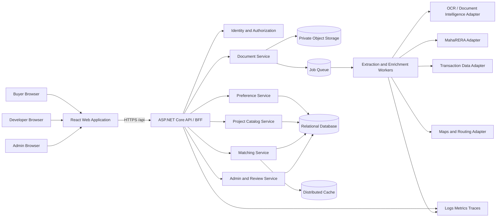
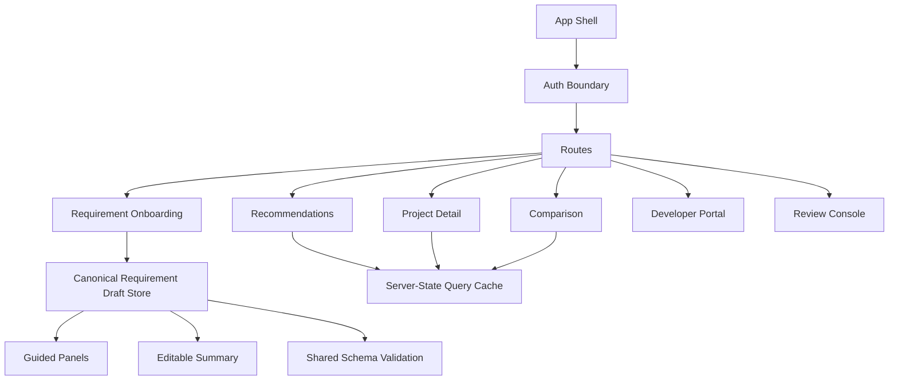
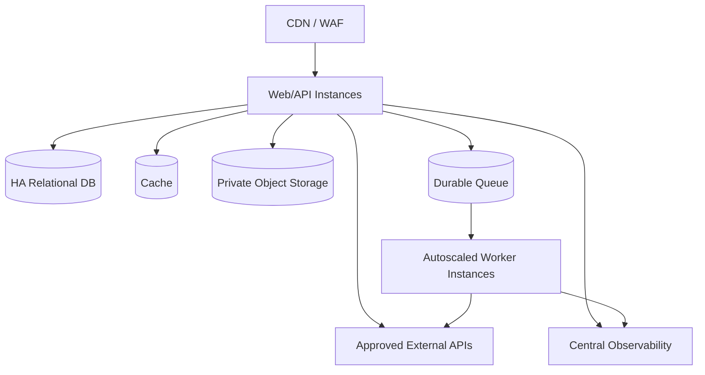

# High-Level Design (HLD)

## 1. Scope

This design covers the buyer web experience, developer ingestion, evidence extraction, MahaRERA verification, project catalog, commute optimization, transaction summaries, ranking, administration, and observability.

## 2. Architecture principles

1. The browser receives normalized data and same-origin asset URLs, never partner credentials or raw storage credentials.
2. User hard constraints are evaluated before preference scores.
3. Every displayed project fact carries provenance, confidence, and freshness.
4. Slow extraction and enrichment use asynchronous jobs; buyer reads use precomputed projections.
5. External providers sit behind replaceable adapters and resilience policies.
6. Personal locations and budgets are isolated from developer access and operational logs.
7. Frontend modes share one canonical draft and API contract.

## 3. Logical architecture

The boxes are logical boundaries. MVP may deploy the API modules as a modular monolith plus one worker process, preserving interfaces that allow later service extraction.

## 4. Recommended technology baseline

- **Frontend:** React + TypeScript, a mature router, TanStack Query (server state), React Hook Form plus schema validation, Fluent UI or equivalent accessible component library.
- **Backend:** ASP.NET Core Web API using controllers/minimal APIs, OpenAPI, policy-based authorization, `IHttpClientFactory`, background workers.
- **Persistence:** PostgreSQL or Azure SQL for transactional data; object storage for evidence; Redis-compatible cache; durable queue for jobs.
- **Document processing:** pluggable OCR/document extraction provider followed by deterministic normalization and review.
- **Search:** relational/full-text search for MVP; dedicated search engine when catalog size, facets, or relevance demand it.
- **Observability:** OpenTelemetry traces, structured logs, metrics, dashboards, and alerts.

Technology choices are recommendations, not requirements; contracts and trust boundaries are the stable design.

## 5. Frontend architecture

### Frontend rules

- Guided and summary onboarding are projections over the same typed form model.
- URLs hold navigational state; server data lives in query cache; ephemeral form state lives in the draft store.
- No document contents, partner URLs, SAS URLs, or access tokens in Redux/global state.
- Project documents are served through authenticated, authorized, same-origin endpoints or time-bounded download actions.
- Use a strict application CSP. If untrusted rich content must be displayed, render a sanitized subset; do not use `dangerouslySetInnerHTML`. Interactive third-party documents require a separately served, narrowly sandboxed document with a dedicated CSP, following the isolation principles in the supplied reference.
- Errors use stable codes and correlation IDs. Authentication expiry is handled by the parent application, not inside embedded content.

## 6. Backend modules

| Module | Responsibility |
| --- | --- |
| Identity/Access | Authentication, roles, organization membership, consent |
| Preferences | Buyer draft/version lifecycle, frequent places, constraints, weights |
| Catalog | Organizations, projects, buildings, units/configurations, facts, evidence |
| Documents | Upload intents, malware status, immutable metadata, access control |
| Extraction | OCR/model orchestration, normalization, confidence and conflicts |
| Verification | MahaRERA resolution, comparisons, verification snapshots |
| Geo | Geocoding, nearby amenities, travel-time matrix and caching |
| Transactions | Partner adapters, project matching, normalization, summaries |
| Metrics | Versioned project and micro-market metric computation |
| Matching | Eligibility filters, scoring, explanations, recommendation snapshots |
| Review/Admin | Review tasks, taxonomies, overrides, feature flags, audit |
| Notifications | Opt-in subscriptions and delivery policies (P1) |

## 7. Primary data flows

### 7.1 Buyer recommendation

1. Buyer edits a draft; frontend validates locally and saves a version through the API.
2. On submit, backend validates, geocodes permitted places, and creates a recommendation request.
3. Matching filters projects by hard constraints and computes weighted components from read models.
4. API returns ranked project summaries plus component explanations and missing-data flags.
5. Selecting a project fetches evidence-backed details and travel breakdown.

### 7.2 Project ingestion

1. Developer creates a project with MahaRERA ID and requests upload intents.
2. Files upload directly to private storage using narrowly scoped, short-lived credentials.
3. Completion event triggers malware scan, type verification, extraction, normalization, and conflict detection.
4. Verification and enrichment adapters fetch authoritative/partner data server-side.
5. Review tasks are created where confidence or consistency rules fail.
6. Approved facts publish atomically into the buyer-facing read model.

## 8. Trust boundaries and security

- **Browser/API:** authenticated HTTPS; CSRF protection where cookie auth is used; strict CORS; request validation.
- **API/storage:** private endpoints/managed identity where available; upload credentials limited by object, method, size, and expiry.
- **Workers/documents:** treat all files and extracted text as untrusted; malware scan and parser isolation; no arbitrary outbound URLs from document content.
- **External integrations:** exact HTTPS host allowlists, redirects disabled or revalidated, bounded size/time, per-provider credentials in a secret store.
- **Admin:** MFA/conditional access, least-privilege roles, step-up confirmation for destructive operations, complete audit trail.

## 9. Deployment topology

Deploy separate development, staging, and production environments with independent identities, storage, databases, provider credentials, and allowlists. Production data must not be copied into lower environments without approved anonymization.

## 10. Availability and resilience

- Idempotency keys for submission, upload completion, and jobs.
- Exponential backoff with jitter for safe partner reads; circuit breakers and bulkheads per provider.
- Dead-letter queue and controlled replay for failed jobs.
- Cached routing/partner results keyed by provider/version/inputs and bounded by freshness policy.
- Transactional outbox for database-to-queue events.
- Graceful degradation: recommendations can show unavailable components rather than fabricate scores.

## 11. Key architecture decisions

| Decision | Rationale |
| --- | --- |
| Modular monolith + workers for MVP | Lower operational cost while preserving clear module boundaries |
| Evidence-first fact model | Required for trust, review, and conflicting documents |
| Precomputed buyer read model | Prevents extraction/partner latency from affecting browsing |
| Server-side integrations | Protects credentials and centralizes validation/licensing controls |
| Separate hard constraints and weighted preferences | Prevents high scores from hiding an unacceptable requirement |
| Dedicated untrusted-content isolation | Keeps the main application CSP strict |

## 12. Risks

- MahaRERA access may not provide a stable licensed API; use a replaceable adapter and approved manual import fallback.
- Partner transaction matching may create false project matches; retain confidence and human correction.
- Traffic estimates vary by time/provider; show assumptions and freshness.
- Subjective quality-of-life metrics can encode bias; publish source/methodology and allow users to choose components.
- Developer marketing claims can conflict with authoritative facts; authoritative/reviewed evidence wins and discrepancies remain visible.
