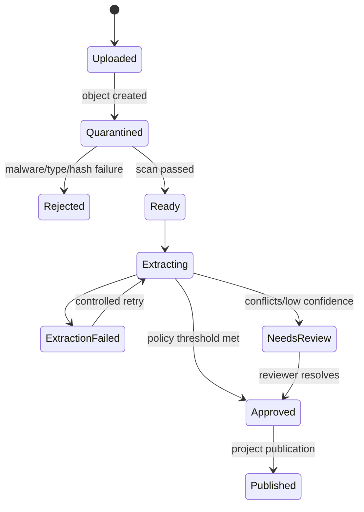

# Low-Level Design (LLD)

## 1. Codebase layout

```text
src/
  Web/                         React TypeScript application
    app/                       routing, providers, error/auth boundaries
    features/onboarding/       guided and summary modes
    features/recommendations/
    features/projects/
    features/comparison/
    features/developer/
    features/review/
    shared/api/                generated typed API client
    shared/components/
    shared/security/
  Api/                         ASP.NET Core host
    Controllers/
    Middleware/
    Authorization/
    Configuration/
  Application/                 use cases, DTOs, validators, interfaces
  Domain/                      entities, value objects, scoring rules
  Infrastructure/              database, storage, queues, external adapters
  Workers/                     extraction/enrichment consumers
  Contracts/                   integration events
  Tests/
```

## 2. Domain aggregates

### 2.1 BuyerRequirementProfile

- `ProfileId`, `OwnerUserId`, `Status`, `Version`, `ConsentVersion`
- `FrequentPlaces[]`
- `HomeRequirements`
- `AmenityPreferences[]`
- `MicroMarketPreferences`
- `Budget`
- `ScoringWeights`
- `AdditionalNeeds`

Rules:
- Drafts may be incomplete; submission requires the active validation schema.
- Hard constraints and soft preferences are explicitly tagged.
- Updates use optimistic concurrency with `Version`/ETag.
- Submitted versions are immutable; edits create a new draft version.

### 2.2 Project

- `ProjectId`, `OrganizationId`, `MahaReraId`, `LifecycleStatus`
- normalized address/geography
- buildings/towers and configurations
- current published fact-set version
- verification status and freshness

Rules:
- A project cannot be published without a validly shaped MahaRERA ID and completed verification attempt.
- Published facts point to reviewed evidence or an authoritative snapshot.
- Developer edits create draft facts and never silently overwrite published facts.

### 2.3 EvidenceDocument and ProjectFact

`EvidenceDocument` tracks immutable object metadata, hash, media type, scan status, uploader, retention, and extraction jobs.

`ProjectFact` contains:
- subject, fact type, typed value and unit
- source/evidence ID and locator (page/region)
- source class (`Authoritative`, `Developer`, `Partner`, `Derived`)
- confidence, freshness, review state
- valid/effective interval
- extractor and schema versions

Conflict selection order is policy driven: current authoritative > human-approved evidence > high-confidence extracted evidence > unreviewed claim. Losing values are retained as conflicts.

## 3. Frontend detailed design

### 3.1 Canonical draft

```ts
interface RequirementDraft {
  id?: string;
  version?: number;
  places: FrequentPlaceInput[];
  home: HomeRequirementInput;
  societyAmenities: AmenityPreferenceInput[];
  nearbyAmenities: NearbyAmenityPreferenceInput[];
  microMarket: MicroMarketPreferenceInput;
  budget: BudgetInput;
  weights: ScoringWeightsInput;
  additionalNeeds?: string;
}
```

Both `GuidedOnboarding` and `RequirementSummaryEditor` consume the same `RequirementDraftProvider`. Section schemas are composed into the submission schema. Persist only after schema normalization; debounce autosave and flush on route change.

### 3.2 Routes

| Route | Access | Purpose |
| --- | --- | --- |
| `/requirements/new` | buyer | New guided draft |
| `/requirements/:id/edit/:section?` | owner/editor | Guided or summary editing |
| `/recommendations/:profileId` | owner/editor | Ranked results |
| `/projects/:projectId` | signed-in/allowed public policy | Project details |
| `/compare?ids=...` | buyer | Side-by-side comparison |
| `/developer/projects/new` | developer | Project creation |
| `/developer/projects/:id/documents` | project editor | Upload and processing status |
| `/review/tasks/:id` | reviewer/admin | Evidence resolution |

Route identifiers are opaque IDs. All route values are encoded; authorization is enforced server-side.

### 3.3 Onboarding panel behavior

Each panel implements `validate`, `summarize`, and `focusFirstError`. Navigation is not blocked by optional omissions. Final submission focuses the first invalid section and announces errors through an ARIA live region.

Panels:
1. Routine destinations
2. Home configuration
3. Space and room expectations
4. Society amenities/substitutions
5. Nearby amenities
6. Micro-market priorities
7. Budget
8. Priorities and additional needs
9. Review and consent

### 3.4 UI states

Every data screen implements loading skeleton, empty state, recoverable error, unauthorized/session-expired state, and stale-data indicator. Retry buttons must not duplicate mutations; mutation calls use idempotency keys.

### 3.5 Safe document rendering

- PDFs/images use an authenticated same-origin media endpoint or viewer that does not receive raw storage credentials.
- Marketing text is rendered as text or through a strict sanitizer with an allowlisted element/attribute set.
- Do not assign untrusted strings to `srcDoc` or `dangerouslySetInnerHTML`.
- If interactive generated HTML is later supported, serve it as a separate authenticated document using iframe `src`, `sandbox="allow-scripts allow-popups"`, no `allow-same-origin`, and a dedicated CSP. The parent application CSP must remain strict.

## 4. API application services

### `RequirementApplicationService`

- `CreateDraft(userId)`
- `GetDraft(profileId, principal)`
- `UpdateDraft(profileId, expectedVersion, patch, principal)`
- `Submit(profileId, expectedVersion, idempotencyKey, principal)`
- `Delete(profileId, principal)`

### `ProjectOnboardingService`

- `CreateProject(orgId, mahaReraId, principal)`
- `CreateUploadIntent(projectId, fileMetadata, principal)`
- `CompleteUpload(projectId, documentId, checksum, principal)`
- `SubmitForReview(projectId, principal)`
- `Publish(projectId, expectedFactSetVersion, reviewer)`

### `Notebook...`

Not applicable. The supplied notebook document is used only for its frontend isolation/security principles; this product does not introduce notebook-specific endpoints.

### `RecommendationService`

1. Load submitted profile version.
2. Query published project read models.
3. Apply hard-constraint predicates.
4. Obtain cached or precomputed component metrics.
5. Normalize component scores to `[0, 1]`.
6. Redistribute no weight implicitly: missing components are identified and confidence reduced according to versioned policy.
7. Persist a recommendation snapshot and return explanations.

## 5. Matching algorithm

For eligible project $p$, profile $u$, components $C$, and user weights $w_c$:

$$
S(p,u) = 100 \times \frac{\sum_{c \in C_{available}} w_c s_c(p,u)}{\sum_{c \in C_{available}} w_c} \times q(p)
$$

where $s_c \in [0,1]$ and $q(p) \in [0,1]$ is evidence-quality confidence. The response must show unavailable components and the applied policy. A project violating any hard constraint is excluded with reason codes.

### Commute score

For destination $d$, frequency $f_d$, estimated duration $t_d$, and user tolerance $T_d$:

$$
s_{commute} = \frac{\sum_d f_d \cdot \max(0, 1 - t_d / T_d)}{\sum_d f_d}
$$

Use configurable alternatives if no tolerance is supplied. Store provider, departure-time assumptions, mode, route timestamp, and cache expiry.

### Budget score

- Exclude when minimum known all-in price exceeds a hard maximum.
- Otherwise score distance from preferred budget band.
- Apply a confidence penalty where charges are incomplete or stale.

## 6. Document pipeline



Worker steps:
1. Verify event/object metadata and idempotency key.
2. Stream file under configured size limit.
3. Scan and identify real media type; never trust extension alone.
4. Run provider-specific extraction in a constrained environment.
5. Normalize units, names, and field types.
6. Link each candidate fact to evidence coordinates.
7. Detect conflicts and create tasks.
8. Write results and outbox event in one transaction.

Folder-based sample ingestion uses `Samples/{locality}/{project}/...` as the project
identity boundary: every supported file below that project directory contributes to
one project and one conflict-preserving combined evidence view. Standalone JPEG/PNG
floor-plan candidates are processed first. If visual classification confirms an
individual pre-cut layout, it is preferred over generated unit crops in layout APIs
and review views; generated crops and source document pages remain auditable fallbacks.

When document-page or model-token budgets apply, individual dwelling layouts are
processed before multi-unit floor plans, amenity pages, and general imagery. Layout
evidence drives room, area, configuration, and comparison calculations; lower-priority
evidence remains queued or explicitly reported as unavailable rather than silently
displacing layouts.

Document parsers must not fetch links embedded in files. Archives, macros, or unsupported active content are rejected for MVP.

## 7. MahaRERA adapter

`IMahaReraProvider`:
- `ResolveByRegistrationIdAsync(id, cancellationToken)`
- returns a typed snapshot and source timestamp, never raw executable content.

Validation:
- normalize case/whitespace only where official rules permit;
- use exact HTTPS provider endpoints/hosts;
- set timeout, response-size bound, retry policy, and cancellation;
- map provider failures to stable internal error categories;
- store source snapshot hash and parsed fields;
- compare through versioned matching rules.

If automated access is unavailable, reviewers may ingest an approved authoritative export. Manual override requires evidence and audit reason.

## 8. External HTTP safety

- Named clients per provider; no mutation of shared default headers.
- Per-request authorization headers.
- Exact configured host allowlists and HTTPS-only URLs.
- Reject user information, fragments, unexpected ports, and malformed URIs.
- Disable redirects; if required later, validate every hop.
- Bound headers/body, media type, charset, timeout, and retries.
- Do not log query credentials, response bodies containing personal data, or uploaded documents.

## 9. Error model

```json
{
  "type": "https://example.invalid/problems/validation",
  "title": "Request validation failed",
  "status": 400,
  "code": "REQ_VALIDATION_FAILED",
  "correlationId": "opaque-id",
  "errors": [{ "field": "budget.maximum", "code": "OUT_OF_RANGE" }]
}
```

Use RFC 9457 problem details. Stable mappings include 400 validation, 401 unauthenticated, 403 unauthorized, 404 hidden/not found, 409 version conflict, 413 upload too large, 422 semantic conflict, 429 throttled, 502 invalid partner response, and 504 partner timeout.

## 10. Configuration

Strongly typed, startup-validated sections:
- `StorageOptions`
- `UploadOptions`
- `DocumentExtractionOptions`
- `MahaReraOptions`
- `RoutingProviderOptions`
- `TransactionProviderOptions`
- `MatchingOptions`
- `SecurityHeaderOptions`
- `RetentionOptions`

Reject wildcard provider hosts, non-HTTPS origins outside local development, invalid bounds, absent production secrets, and unsupported scoring policy versions.

## 11. Authorization matrix

| Action | Buyer | Developer | Reviewer | Admin |
| --- | ---: | ---: | ---: | ---: |
| Edit own requirement | Yes | If also buyer | No | Support-only audited access |
| View published project | Yes | Yes | Yes | Yes |
| Edit organization project | No | Organization member | No | Yes |
| Approve extracted facts | No | No | Yes | Yes |
| Publish project | No | No | Yes | Yes |
| Configure providers/taxonomy | No | No | No | Yes |

Object-level checks are mandatory in addition to role checks.

## 12. Background job contracts

Events contain opaque entity IDs, schema version, causation/correlation IDs, attempt, and occurred time. They do not contain document bodies, SAS credentials, exact buyer addresses, or access tokens.

Consumers use an inbox table for deduplication. Poison events move to a dead-letter queue after configured attempts and require an audited replay.

## 13. Observability

- Structured event names, not free-form document/user content.
- Trace spans for API use case, database, queue, extraction stage, and each provider.
- Metrics: queue age, extraction duration/failure, review backlog, publish latency, recommendation duration, provider latency/errors, cache hit rate.
- Sensitive fields are classified and redacted at source.
