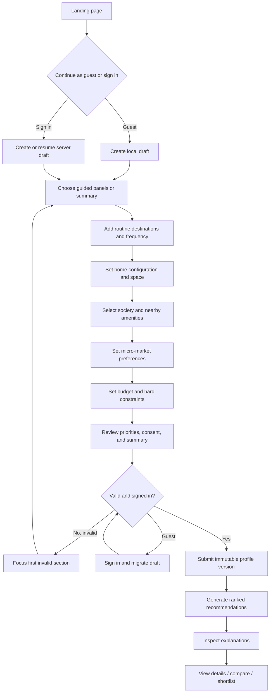
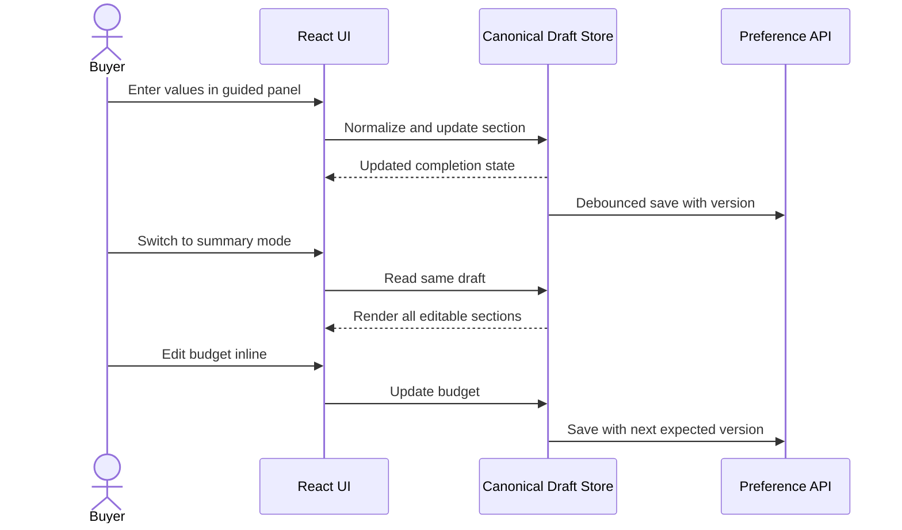
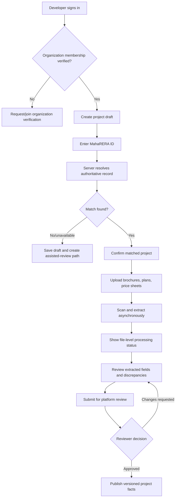
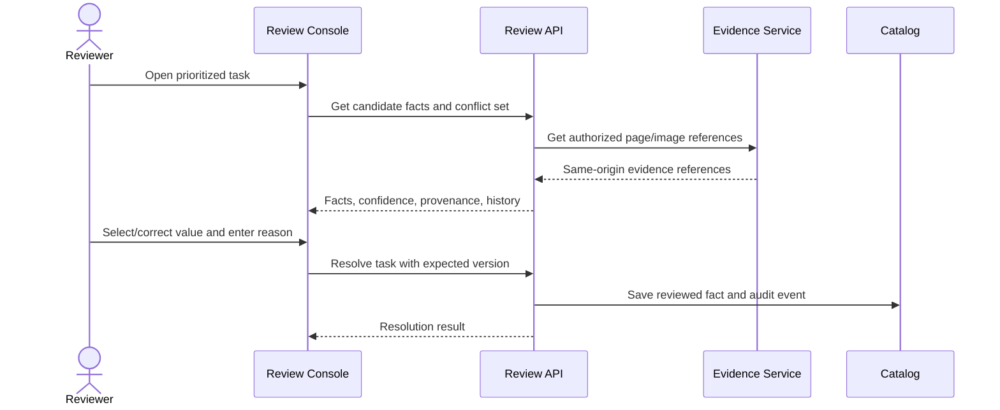

# User Flows

## 1. Buyer onboarding and recommendations

### Alternate and failure paths

- Place search unavailable: allow manual locality selection and clearly mark commute as pending.
- Autosave conflict: fetch latest version, show changed sections, and ask user to merge rather than overwrite.
- Session expired: preserve non-sensitive draft state, trigger parent sign-in, then retry once.
- No matches: show which hard constraints eliminated projects and allow direct edits; do not silently relax constraints.
- Partial metrics: display available recommendations with explicit unavailable/stale components.

## 2. Switch onboarding modes

There is no conversion between two independent forms; both modes use the same model and validation rules.

## 3. Project search, details, and comparison

1. Buyer opens recommendations or search.
2. Filters modify URL query state and request server-side results.
3. Cards show key facts, match score components, MahaRERA state, and freshness.
4. Buyer opens project details.
5. Detail view shows evidence-backed project facts, commute per destination, price definitions, amenities and alternatives, developer history, and local transaction summary.
6. Buyer adds 2–4 projects to comparison.
7. Comparison aligns units, highlights hard-constraint failures and differences, and preserves missing-data labels.
8. Buyer shortlists or creates an expiring read-only share link.

Failure behavior: a removed/unpublished project is shown as unavailable without leaking draft or moderation details.

## 4. Developer project onboarding

Developer users cannot approve their own evidence or alter authoritative snapshots.

## 5. Evidence review flow

Reviewers must see source location, extraction version, competing values, and prior decisions. Bulk approval is limited to low-risk fields with equivalent provenance and confidence.

## 6. MahaRERA discrepancy flow

1. Verification worker fetches/resolves an authoritative snapshot.
2. Comparison rules identify name, promoter, address, date, or configuration discrepancies.
3. Project status becomes `NeedsVerificationReview`; existing published data remains until an explicit policy says otherwise.
4. Reviewer compares source and developer evidence.
5. Reviewer confirms authoritative value, marks a legitimate alias, requests correction, or records source unavailability.
6. Publication includes status and verification timestamp; all decisions are audited.

## 7. Local-sales summary flow

1. Enrichment worker requests licensed records with server-held credentials.
2. Adapter normalizes and deduplicates records.
3. Project matcher assigns confidence using MahaRERA ID, normalized name, address, and building identifiers.
4. Low-confidence matches enter review; only approved/high-confidence records enter summaries.
5. Metrics worker computes count, median/percentiles, rate per carpet square foot where source supports it, and period coverage.
6. UI labels source, coverage, freshness, and distinction from asking prices.

## 8. Theme and responsive frontend flow

1. Application theme changes through the central theme provider.
2. Native React components update without reload.
3. Charts and maps consume semantic design tokens rather than hard-coded colors.
4. Any future isolated document receives only a validated `light`/`dark` enum in its same-origin URL and reloads; arbitrary style URLs are forbidden.
5. Mobile onboarding uses one panel per viewport; summary mode uses collapsible sections with persistent completion indicators.

## 9. Account privacy and deletion flow

1. Buyer opens privacy settings and reviews stored profile categories.
2. Buyer may remove a destination, delete requirement history according to policy, revoke shares, export data, or request account deletion.
3. Destructive requests require reauthentication and confirmation.
4. API creates an auditable deletion workflow; immediately revokes sessions/shares and schedules deletion/anonymization across stores.
5. Legal/audit retention exceptions are disclosed and access-restricted.
6. User receives completion status without exposing internal storage details.

## 10. Administrator operational flow

- View integration health, stale datasets, queue backlog, and failed jobs.
- Update taxonomies/configuration through versioned changes and feature flags.
- Reprocess selected documents by extraction version.
- Replay dead-letter jobs only after root-cause annotation.
- Suspend a project or organization with reason and notification workflow.
- Access to personal profiles is exceptional, time-bound, purpose-recorded, and audited.

## 11. Status models

### Requirement profile

`Draft → Submitted → Active → Superseded → Deleted/Anonymized`

### Project

`Draft → Verifying → Ingestion → NeedsReview → Approved → Published → Suspended/Archived`

### Document

`Uploaded → Quarantined → Ready → Extracting → NeedsReview/Approved → Published`, with terminal `Rejected` and retryable `ExtractionFailed`.

### Recommendation

`Requested → Computing → Ready`, with `PartiallyReady`, `Failed`, and `Expired` outcomes.
