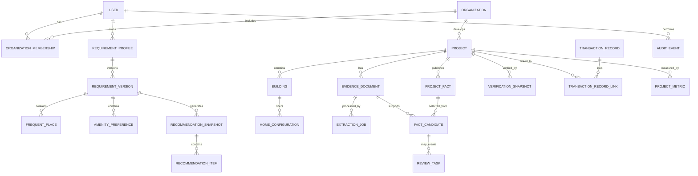

# Data Model and Data Governance

## Expanded ingestion artifacts (Django implementation)

See [the output contract](11-document-ingestion-and-project-outputs.md) for the latest document report schema. No additional relational tables are required for this increment:

- `IngestionRun.summary.projectOutput` stores a versioned document-scoped project snapshot with candidate evidence, conflict/unknown statuses, external source provenance and processing status.
- `IngestionRun.summary.outputs` stores the internal immutable artifact keys and public authenticated download URIs. Serializers remove internal storage keys.
- Run status `needs_provider` means a report is available but required visual analysis is incomplete; `failed` runs are excluded from successful report retrieval.
- `FloorPlanAsset` also holds categorized design/amenities page derivatives. `source_bounds.category` distinguishes `general`, `floor-plans`, `layouts`, `amenities`, and `unclassified`. Artifacts are referenced by URI, not serialized as binary image fields.
- Original document `object_key` is updated during verified todo/completed relocation. Source SHA-256 and document ID stay stable; old objects are deleted only after commit.
- `ReviewTask(task_type="project_output")` references `ingestionRunId`. Generated reports are unreviewed and do not create published project facts automatically.
- Layout-metric JSON/CSV snapshots remain linked to their original ingestion run even when mutable logical floor-plan records are changed by later reprocessing.

Retention/deletion must cover both legacy media and workspace user/output storage, including orphaned copies after interrupted transactions. No automatic cleanup of historical reports is introduced in this increment.
## 1. Entity relationship model

## 2. Core tables

### Identity and organizations

- `users(id, identity_subject, status, locale, created_at, deleted_at)`
- `organizations(id, legal_name, status, verification_state, created_at)`
- `organization_memberships(organization_id, user_id, role, status, version)`
- `consents(id, user_id, purpose, policy_version, granted_at, withdrawn_at)`

Do not duplicate identity-provider credentials in application tables.

### Buyer requirements

- `requirement_profiles(id, owner_user_id, status, active_version_id, created_at, updated_at)`
- `requirement_versions(id, profile_id, version, payload_json, schema_version, status, submitted_at)`
- `frequent_places(id, requirement_version_id, provider_place_id, encrypted_coordinates, display_locality, precision, frequency, mode_json, tolerance_minutes)`
- `profile_shares(id, profile_id, grantee_id_or_token_hash, permissions, expires_at, revoked_at)`

Normalized query columns may be projected from immutable version payloads. Exact coordinates use application-level encryption if threat modeling requires field isolation.

### Catalog

- `projects(id, organization_id, maha_rera_id, status, published_fact_set_version, geo_point, locality_id, created_at)`
- `buildings(id, project_id, name, status)`
- `home_configurations(id, building_id, configuration_type, carpet_area_min, carpet_area_max, bathrooms, balconies, fact_set_version)`
- `amenities(id, taxonomy_code, display_name, category)`
- `project_amenities(project_id, amenity_id, availability_state, fact_id)`

Use database uniqueness for normalized MahaRERA ID where official uniqueness is assured. Potential aliases remain explicit records, not fuzzy uniqueness keys.

### Evidence and facts

- `evidence_documents(id, project_id, object_key, original_name, declared_media_type, detected_media_type, bytes, sha256, scan_status, status, uploaded_by, created_at, retention_until)`
- `extraction_jobs(id, document_id, extractor_version, status, attempt, started_at, completed_at, error_category)`
- `fact_candidates(id, project_id, document_id, field_code, typed_value_json, unit, page_number, bounding_region_json, source_class, confidence, extractor_version, review_state, created_at)`
- `project_facts(id, project_id, field_code, typed_value_json, unit, source_class, selected_candidate_id, status, valid_from, valid_to, reviewed_by, reviewed_at, fact_set_version)`
- `fact_conflicts(id, project_id, field_code, candidate_ids_json, state, resolution_id)`
- `review_tasks(id, project_id, type, priority, state, assigned_to, version, created_at, completed_at)`

Object keys are opaque and never derived directly from filenames. Store credentials nowhere in these tables.

### Verification and enrichment

- `verification_snapshots(id, project_id, provider, provider_record_id, retrieved_at, fields_json, snapshot_hash, match_result, adapter_version)`
- `transaction_records(id, provider, provider_record_id_hash, registration_date, amount, currency, area, area_unit, normalized_json, retrieved_at)`
- `transaction_record_links(id, transaction_record_id, project_id, confidence, reason_codes_json, review_state)`
- `project_metrics(id, project_id, metric_code, numeric_value, unit, confidence, definition_version, input_snapshot_hash, calculated_at, valid_until)`
- `micro_market_metrics(id, locality_id, metric_code, numeric_value, source, definition_version, calculated_at, valid_until)`

Raw partner data retention and redistribution must follow license terms. Hash identifiers where raw values are not necessary.

### Recommendations

- `recommendation_snapshots(id, requirement_version_id, algorithm_version, input_catalog_version, state, generated_at, expires_at)`
- `recommendation_items(snapshot_id, project_id, rank, score, confidence, component_json, reason_codes_json)`
- `travel_estimates(id, origin_cell_or_encrypted_point, destination_id, mode, departure_bucket, provider, duration_seconds, distance_meters, retrieved_at, expires_at)`

Avoid storing precise home/work coordinates in cache keys. Use encrypted identifiers or acceptable geographic cells based on privacy review.

### Operations

- `outbox_messages(id, event_type, schema_version, payload_json, occurred_at, published_at)`
- `inbox_messages(consumer, message_id, processed_at, result)`
- `audit_events(id, actor_id, action, entity_type, entity_id, reason_code, correlation_id, occurred_at, metadata_json)`
- `feature_flags(key, environment, state, targeting_rule_version, updated_at)`

Audit metadata excludes document contents, precise places, budget values, tokens, and signed URLs.

## 3. Data classifications

| Classification | Examples | Controls |
| --- | --- | --- |
| Restricted personal | precise frequent places, budget, identity subject | field minimization, encryption, narrow access, redacted logs, deletion workflow |
| Confidential | unpublished project files, review notes, partner records | organization/reviewer authorization, private storage, audit |
| Internal | extraction confidence, operational metrics, provider errors | employee/service access only |
| Public | approved published project facts and attribution | publication review, provenance, integrity/versioning |

## 4. Provenance requirements

Every public fact must expose or internally retain:
- source class and evidence ID;
- page/region when derived from a document;
- extraction/adapter version;
- confidence and human-review status;
- retrieval/publication timestamps;
- unit and area definition;
- supersession history.

Derived metrics additionally retain definition version and an input snapshot hash so results can be reproduced.

## 5. Retention and deletion

Exact periods require legal and licensing approval. Initial policy categories:

- Guest drafts: browser session or short local expiry.
- Abandoned signed-in drafts: short configurable period after inactivity.
- Submitted profiles and recommendations: retained while account is active or user requests deletion, subject to required audit exceptions.
- Rejected/quarantined uploads: short incident-safe retention, then hard deletion.
- Published evidence: retained while facts rely on it and permitted by license/contract.
- Provider raw responses: minimum period required for reproducibility and no longer than license permits.
- Audit/security records: separate protected retention schedule; personal payloads excluded.

Deletion uses a workflow with per-store completion records, retries, legal-hold checks, and anonymization where deletion would break required aggregate integrity.

## 6. Indexes and constraints

- Unique `(profile_id, version)` and `(project_id, fact_set_version, field_code)` where only one selected fact is permitted.
- Unique document SHA-256 per project when duplicate upload behavior is rejected/merged.
- Spatial index on project geography and approved amenity locations.
- Search indexes on locality, normalized project/promoter names, configuration, price, and possession.
- Partial indexes for open review tasks and active projects.
- Check constraints for non-negative money/area, confidence in `[0,1]`, and valid intervals.
- Foreign keys use restrictive deletion by default; deletion workflows explicitly order dependent cleanup.

## 7. Data quality

- Canonical units: INR, square feet for buyer display, but retain original unit/value.
- Canonical area type: carpet area; never convert super-built-up to carpet without a sourced conversion.
- Names: retain official and submitted forms plus aliases; do not overwrite originals.
- Addresses: componentized and geocoded with confidence.
- Dates: distinguish declared, authoritative, estimated, and actual.
- Freshness policy is field/source specific and shown to users.

## 8. Backup and recovery

- Point-in-time recovery for the relational store.
- Versioning/soft-delete protection for evidence storage, with access restrictions and lifecycle policies.
- Queue dead-letter retention and replay procedure.
- Regular restore tests with documented recovery time and recovery point objectives.
- Encryption key backup/rotation procedures that preserve authorized recovery and deletion guarantees.
