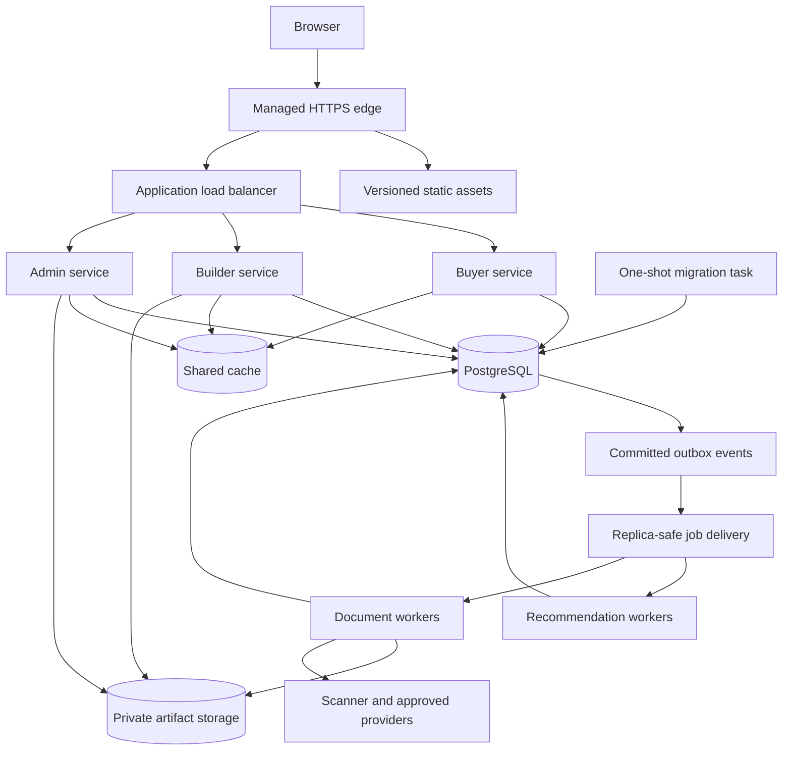

# Cloud-native architecture review

Reviewed: 22 October 2026.

What this repo does: MMR Homefinder ingests builder documents, extracts project and floor-plan evidence, supports review/publication, and serves buyer browsing and recommendations. Its Django/React modular monolith has three web entrypoints, shared PostgreSQL, a private media store, and durable background work.

Load assumed: the documented target of a brief peak of roughly 1,000 concurrent browsing users, with builder/admin activity and background ingestion. This is not measured capacity or 1,000 requests/second. The SLOs in the delivery specification remain proposals.

**Verdict: useful cloud-ready foundations, but deployment and worker ownership still depend on a single active processing unit. Make replicas safe before increasing replica counts.**

This is a repository assessment. The existing EC2/RDS/EFS information is documented state, not a live AWS inventory. No cloud resources were queried or changed.

## Keep these foundations

Keep the Django domain and shared PostgreSQL schema. Cloud-native deployment does not require a microservice rewrite. Preserve transactional outbox/inbox deduplication, operation status, retries and controlled dead-letter replay, object-level authorization, CSRF protection, checksums, private media endpoints, independent review gates, and immutable outputs. The multi-stage image, migration owner, health endpoints and initial telemetry also provide a good starting point.

## Recommended target

Start with AWS because the repository documents existing AWS state. Use independent ECS services for buyer, builder, admin and workers, managed PostgreSQL, a shared cache, private artifact storage, and a separate migration task. Keep one application image initially if useful. Put recommendation and heavy extraction work in separate capacity pools.

Use multiple web replicas across availability zones where the approved availability target requires surviving task/zone loss. Scale each independently. Job delivery can remain PostgreSQL-backed after redesigning claims; a managed queue plus outbox relay is an alternative. EFS can bridge the transition to object storage.

## Must fix for this production target

### 1. Separate deployment and failure units

- **What this is:** The current documented path uses one EC2 host. The ECS alternative bundles gateway, all three web services and an essential worker in one task. Azure bundles them in one app with one replica.
- **Problem:** Host or worker failure affects every web surface. ECS starts overlapping old/new tasks during rolling deployment, but the new dispatcher exits while the old dispatcher holds its singleton lock. This deployment conflict is inferred from code, not reproduced live.
- **Fix:** Create independent web/worker services, targets, identities, resource limits, health and scaling policies. Replace loopback gateway upstream assumptions with load-balancer routing/service discovery.
- **If skipped:** Deployments, traffic spikes and extraction failures keep affecting the whole product together.

Evidence: [EC2 deployment](../.deployments/aws/ec2/README.md), [ECS essential worker and rolling settings](../.deployments/aws/terraform/ecs.tf), [forced singleton count](../.deployments/aws/terraform/variables.tf), [Azure replica limit](../.deployments/azure/terraform/container-apps.tf), [dispatcher singleton](../reailEstate/reailEstate_common/backend/platform_api/automatic_queue.py). AWS documents [essential-container failure](https://repost.aws/knowledge-center/ecs-run-task-cluster) and [service autoscaling](https://docs.aws.amazon.com/AmazonECS/latest/developerguide/service-auto-scaling.html).

### 2. Share cross-request cache state

- **What this is:** Admin review drafts and DRF throttles use Django cache, without a configured shared cache backend.
- **Problem:** A draft saved by process A can be missing when the next request reaches process B, even with multiple Gunicorn workers on one host. Throttling also varies by process and resets on restart.
- **Fix:** Configure managed Redis-compatible shared caching. Preserve user/project draft scoping and TTLs; use PostgreSQL for drafts that must survive cache eviction. Add atomic enforcement for strict quotas and appropriate edge abuse controls.
- **If skipped:** Increasing process/replica count creates intermittent review failures and inconsistent limits.

Evidence: [draft reads/writes at lines 568/692](../reailEstate/reailEstate_common/backend/platform_api/external_sources_admin.py), [cache-dependent throttle settings](../reailEstate/reailEstate_common/backend/config/settings.py). DRF describes its [non-atomic cache-based throttling](https://www.django-rest-framework.org/api-guide/throttling/).

### 3. Make job ownership replica-safe and isolate work classes

- **What this is:** The dispatcher holds a global session advisory lock. Extraction, enrichment and recommendations share its capacity.
- **Problem:** A second dispatcher fails instead of adding capacity. Long document/model calls can occupy every slot while buyer recommendations wait.
- **Fix:** Preserve outbox/inbox semantics. Use short transactional claims, renewable leases, and fencing/version checks so an expired owner cannot commit after replacement. Separate recommendation and heavy-processing capacity. Scale by queue age/backlog, with database/provider ceilings. Alternatively, relay committed outbox events to managed queues with deduplicating consumers and controlled replay.
- **If skipped:** More worker containers do not deliver useful parallelism and heavy processing delays buyer workflows.

Evidence: [reservation/dispatcher](../reailEstate/reailEstate_common/backend/platform_api/automatic_queue.py), [locks](../reailEstate/reailEstate_common/backend/platform_api/ingestion_runtime.py), [event groups](../reailEstate/reailEstate_common/backend/platform_api/jobs/events.py), [inbox uniqueness](../reailEstate/reailEstate_common/backend/platform_api/models.py). [AWS outbox guidance](https://docs.aws.amazon.com/prescriptive-guidance/latest/cloud-design-patterns/transactional-outbox.html) requires handling duplicate delivery.

### 4. Handle termination and bounded recovery

- **What this is:** The dispatcher catches KeyboardInterrupt but has no SIGTERM handler. Task stop budgets are 60 seconds; provider calls can take much longer.
- **Problem:** Routine deployment/scale-in can terminate work without setting its stop event or completing cleanup. Existing locks/retries help recovery but cannot prevent repeated expensive calls.
- **Fix:** On SIGTERM stop claiming, report draining, and finish/checkpoint within a deadline. Make interrupted attempts reclaimable and outputs idempotent. Bound the total fallback-chain duration and test termination during scan, provider call and commit.
- **If skipped:** Releases and scale-in repeatedly interrupt jobs, repeat costs or consume retry budgets.

Evidence: [dispatcher command](../reailEstate/reailEstate_common/backend/platform_api/management/commands/run_extraction_dispatcher.py), [retry/recovery](../reailEstate/reailEstate_common/backend/platform_api/workers.py), [task stop budgets](../.deployments/aws/terraform/ecs.tf). ECS [eventually forces termination](https://docs.aws.amazon.com/AmazonECS/latest/APIReference/API_StopTask.html).

### 5. Keep extraction out of HTTP requests

- **What this is:** ProjectIngestionQueueView.post directly executes process_pending_outbox for up to 20 jobs. Guest matching also calculates synchronously.
- **Problem:** A builder request can run scanning, extraction and provider calls inside Gunicorn and exceed server/proxy timeouts.
- **Fix:** Make the builder action enqueue/retry authorized jobs and return an operation with HTTP 202. Retain status polling. Keep guest matching synchronous only while measured bounded work fits its request budget; otherwise use an expiring operation flow preserving guest privacy/consent.
- **If skipped:** A few processing requests can exhaust web execution capacity.

Evidence: [queue execution at line 906 and guest scoring at line 483](../reailEstate/reailEstate_common/backend/platform_api/views.py).

### 6. Stream uploads outside long database transactions

- **What this is:** DocumentContentUploadView holds a transaction/row lock while reading up to 100 MiB, checking it and writing storage.
- **Problem:** Concurrent uploads allocate large buffers and hold database resources through storage I/O. Storage writes do not roll back with a failed DB transaction.
- **Fix:** Stream to unique private staging storage with incremental size/hash checks; finalize in a short version-checked transaction and reconcile abandoned objects. Direct object-store uploads are optional and require a separate security design for scoped authorization, immutable version binding and completion verification.
- **If skipped:** Upload bursts can exhaust memory/connections and leave orphaned artifacts.

Evidence: [upload handler, lines 834–858](../reailEstate/reailEstate_common/backend/platform_api/views.py).

### 7. Operate the dependencies promised by enabled workflows

- **What this is:** EC2 startup stops the worker; scanning is disabled and provider configuration is not deployed. The unavailable scanner correctly rejects processing.
- **Problem:** Browsing readiness can pass while uploads and signed-in recommendations remain queued. Starting the worker alone does not make untrusted ingestion usable.
- **Fix:** Run workers continuously for enabled workflows. Deploy/monitor the scanner and signature freshness, securely deliver approved vision profiles/credentials, and validate conversion dependencies for enabled formats. Show workflow availability and queue delay; gate unavailable capabilities explicitly.
- **If skipped:** The application appears healthy while core asynchronous actions never complete or exhaust retries.

Evidence: [startup](../.deployments/aws/ec2/start.sh), [processing profile](../.deployments/aws/ec2/compose.yml), [defaults](../.deployments/aws/ec2/app.env.example), [rejecting scanner](../reailEstate/reailEstate_common/backend/platform_api/integrations.py).

### 8. Establish database HA and verified recovery

- **What this is:** AWS Terraform has single-AZ RDS, deletion protection off by default and skip_final_snapshot=true. Azure does not configure database HA. Existing live settings were not checked.
- **Problem:** Replicated web services still depend on database-instance availability; destructive changes can omit a final snapshot.
- **Fix:** Select HA for the approved availability target, enforce deletion/final-snapshot protection and PITR/backup retention, define acceptable data loss/recovery time, and restore DB plus evidence into an isolated environment. Choose cross-region/account protection according to the recovery target.
- **If skipped:** Compute redundancy does not provide end-to-end availability and recovery is unproven.

Evidence: [AWS database](../.deployments/aws/terraform/database.tf), [defaults](../.deployments/aws/terraform/variables.tf), [Azure database](../.deployments/azure/terraform/database.tf). [RDS Multi-AZ failover](https://docs.aws.amazon.com/AmazonRDS/latest/UserGuide/Concepts.MultiAZ.Failover.html) complements backups.

### 9. Make releases and migrations compatible with rolling deployment

- **What this is:** EC2 replaces containers on one host; migrations require stopping writers and failed releases can partially replace containers. The cloud alternatives already have separate migration tasks/jobs.
- **Problem:** Releases interrupt traffic and an old image may not work after an incompatible schema migration.
- **Fix:** Keep migrations separate from web startup. Serialize migrations and use expand/contract changes: add compatible structures, deploy compatible code, backfill in bounded jobs, remove old structures later. Add readiness-gated rollout, smoke tests and rollback thresholds.
- **If skipped:** Changes continue to require outages and image rollback may fail.

Evidence: [release instructions](../.deployments/aws/ec2/README.md), [deployment script](../.deployments/aws/ec2/deploy-release.sh), [migration task](../.deployments/aws/terraform/ecs.tf).

### 10. Fail startup on incomplete production configuration

- **What this is:** Shared settings default to debug enabled, a development secret/environment, SQLite without a local PostgreSQL config, and PostgreSQL TLS mode prefer. Deployment definitions override many correctly.
- **Problem:** An omitted setting in a new service can silently select development behavior or ephemeral SQLite state.
- **Fix:** Require an explicit runtime environment and validate PostgreSQL selection, non-placeholder secret, debug off, hosts/origins, secure cookies, proxy trust, verified database TLS and required dependency configuration before serving traffic. Keep development defaults isolated and run Django deployment checks.
- **If skipped:** Configuration mistakes can create insecure or non-durable replicas.

Evidence: [settings at lines 30, 33, 103, 114 and 266](../reailEstate/reailEstate_common/backend/config/settings.py), [EC2 overrides](../.deployments/aws/ec2/app.env.example).

### 11. Separate runtime privileges and manage secret rotation

- **What this is:** ECS shares one workload identity/filesystem write scope. Runtime and migrations use the configured database administrator account. EC2 copies env secrets per release. The Dockerfile/ECS definitions lack the non-root override present in EC2 Compose.
- **Problem:** A buyer-process compromise gains writer/schema capabilities; rotation relies on updating secret copies; cloud-template app containers default to root.
- **Fix:** Give web/worker services scoped identities, runtime DB grants and a distinct DDL-capable migration role. Inject platform secrets, define restart/reload and signing-key rotation behavior, run non-root with explicit scratch space and read-only roots where supported. Protect administrator access with MFA/SSO or restricted access controls.
- **If skipped:** Compromise affects more data/capabilities and credential changes risk downtime.

Evidence: [shared IAM](../.deployments/aws/terraform/identity.tf), [runtime credentials](../.deployments/aws/terraform/locals.tf), [DB administrator](../.deployments/aws/terraform/database.tf), [Dockerfile](../reailEstate/Dockerfile), [EC2 user](../.deployments/aws/ec2/compose.yml).

### 12. Establish one infrastructure authority

- **What this is:** Existing console-created AWS resources are outside the alternative Terraform stack; its README explicitly warns that apply creates a separate stack.
- **Problem:** Applying it can create a second DB/media store instead of managing current data, while console changes drift from reviewed code.
- **Fix:** Inventory resources, then deliberately import/adopt them or execute a verified migration. Use protected remote state with locking/versioning, isolated environment credentials/states, reviewed plans and drift checks. Reconcile documented database-version and EFS path/access-point differences.
- **If skipped:** Automation can create duplicate costs or point the app at empty state.

Evidence: [authority warning](../.deployments/aws/README.md), [existing resources](../.deployments/aws/ec2/README.md), [state example](../.deployments/aws/terraform/backend.hcl.example), [EFS access point](../.deployments/aws/terraform/storage.tf).

## Should fix during the transition

### 13. Decouple artifacts from filesystem layout

- **What this is:** RoutedStorage constructs FileSystemStorage for user/media and output/media; the runtime contract mandates shared /workspace and admin reports read filesystem paths directly. A third active path is Django default storage: Project.project_pic still writes project-pictures through ImageField. The local backend/media directory therefore is not merely historical storage, despite the cloud mount name legacy-media.
- **Problem:** Changing Django default storage does not affect those namespaces; mounts/directories/permissions remain a cross-service dependency.
- **Fix:** Make the existing storage seam configurable for current and legacy keys. Prefer private S3/Blob for evidence/generated artifacts, ephemeral scratch and durable report state. Migrate with a checksum/key manifest, permission verification and reversible cutover. Prefer DB workflow state to physical todo/completed moves; reconcile writes/deletes across DB commits.
- **If skipped:** Managed shared files can still support replicas, but storage coupling remains. Object storage is a recommended fit here, not a universal cloud-native requirement.

Evidence: [storage routing/movement](../reailEstate/reailEstate_common/backend/platform_api/artifact_storage.py), [report files](../reailEstate/reailEstate_common/backend/platform_api/external_sources_admin.py), [runtime contract](../.deployments/README.md).

### 14. Budget database connections and recommendation work

- **What this is:** CONN_MAX_AGE=0; web, workers and heartbeats use PostgreSQL. Recommendations load catalogue/layout data; travel estimation checks cached routes per origin/destination/mode.
- **Problem:** More replicas multiply connection demand and repeated work. Transaction pooling would break the existing session advisory locks.
- **Fix:** Measure query/connection demand, set bounded pools and an aggregate budget with failover/migration headroom, and preserve direct/session-pooled lock connections. Batch route-cache reads, apply safe hard filters early and version/cache public projections. Move long computation/provider I/O out of long DB transactions and commit checked results briefly. Revisit per-request session writes without silently changing expiry behavior.
- **If skipped:** Database saturation follows app scaling, or an incompatible pooler breaks ownership.

Evidence: [DB/session settings](../reailEstate/reailEstate_common/backend/config/settings.py), [scoring](../reailEstate/reailEstate_common/backend/platform_api/services.py), [travel loops](../reailEstate/reailEstate_common/backend/platform_api/travel.py), [lock contract](../reailEstate/reailEstate_common/backend/platform_api/ingestion_runtime.py). PgBouncer documents [transaction-pooling incompatibility](https://www.pgbouncer.org/features.html).

### 15. Give each service meaningful health checks

- **What this is:** Gateway readiness checks buyer only; Django readiness executes SELECT 1. EC2 has no ongoing app healthchecks; integration health reports flags rather than successful probes.
- **Problem:** Buyer/DB success can coexist with failed builder, inaccessible media or stalled processing. Restart policies do not detect a process that is alive but hung.
- **Fix:** Use per-service startup/readiness/liveness, bounded readiness with HTTP 503 on failure, and probes exempt from business throttles. Monitor worker heartbeat/progress and run separate workflow/dependency synthetics. Keep liveness local and avoid making buyer readiness depend on every optional provider.
- **If skipped:** Traffic reaches broken services or broad probes unnecessarily remove healthy ones.

Evidence: [gateway](../.deployments/aws/gateway/nginx.conf), [health/integration views](../reailEstate/reailEstate_common/backend/platform_api/views.py), [Compose](../.deployments/aws/ec2/compose.yml), [worker heartbeat](../reailEstate/reailEstate_common/backend/platform_api/queue_monitor.py).

### 16. Export metrics, alert and trace background work

- **What this is:** HTTP tracing, ingestion logs, admin metrics and cloud log/trace templates exist. EC2 disables OTEL by default and retains logs locally. No alarm/dashboard definitions were found in reviewed Terraform.
- **Problem:** Queue stalls and latency breaches may go unnoticed; HTTP instrumentation does not connect enqueue to provider calls and completion.
- **Fix:** Centralize structured logs and propagate trace/correlation/message/operation IDs through jobs. Export request latency/errors, queue age by class, job duration/DLQs/heartbeat, provider failures/quotas/cost, DB/cache/storage saturation. Add SLO alerts with owners; redact private payloads and bound metric cardinality.
- **If skipped:** Operations and scaling rely on manual diagnosis after user reports.

Evidence: [tracing](../reailEstate/reailEstate_common/backend/platform_api/observability.py), [metrics views](../reailEstate/reailEstate_common/backend/platform_api/views.py), [cloud telemetry](../.deployments/aws/terraform/observability.tf), [EC2 defaults](../.deployments/aws/ec2/app.env.example).

### 17. Promote one reproducible, verified artifact

- **What this is:** GitHub manually builds/packages images and runs SQLite Django checks and gateway validation. It omits backend/frontend regression tests and PostgreSQL integration. Python/base-image versions include ranges/moving tags.
- **Problem:** Build success does not prove runtime/migration/ownership correctness; rebuilding source can resolve different dependencies.
- **Fix:** Add PR gates, PostgreSQL integration, frontend/migration checks and ephemeral release smoke tests. Lock dependencies, deploy image digests, gate artifact scans by an agreed policy, retain provenance/SBOM and rollback digests, and promote the same artifact. Use scoped short-lived CI identity for deployment. Preserve existing immutable ECR tags/scanning.
- **If skipped:** Green builds remain weak release evidence and deployment remains partly manual.

Evidence: [workflow](../.github/workflows/aws-ec2-release.yml), [dependencies](../reailEstate/reailEstate_common/backend/requirements.txt), [image build](../reailEstate/Dockerfile), [ECR](../.deployments/aws/terraform/registry.tf). AWS describes [GitHub OIDC roles](https://aws.amazon.com/blogs/security/use-iam-roles-to-connect-github-actions-to-actions-in-aws/).

### 18. Finish edge delivery and network boundaries

- **What this is:** Current edge runs on EC2. ECS tasks have public IPs with restricted inbound groups; CloudFront-to-ALB uses HTTP and edge caching is disabled. Azure POC storage/vault use public service endpoints.
- **Problem:** Edge shares host failure risk; static traffic consumes origin resources; trust/egress boundaries remain POC choices. Moving proxies changes client-IP attribution.
- **Fix:** Use managed HTTPS ingress, origin restrictions and abuse protection. Decide/enforce origin TLS and least-required egress. Prefer deliberately costed private networking or document an equivalent restricted public-task design. Cache fingerprinted assets; cache public catalogue only with correct keys/invalidation. Preserve private/no-store behavior, CSP, CSRF and session rules.
- **If skipped:** Origin cost grows unnecessarily and security assumptions diverge between environments.

Evidence: [network](../.deployments/aws/terraform/network.tf), [edge policies](../.deployments/aws/terraform/load-balancing.tf), [routes/static assets](../.deployments/aws/gateway/nginx.conf), [Azure limitations](../.deployments/azure/README.md).

### 19. Schedule retention/reconciliation and report deletion truthfully

- **What this is:** retention_until exists without a general enforcement scheduler found. Account deletion immediately reports completed while disabling the user and marking profiles deleted; requirement payloads remain. DeletionRecord has no non-migration runtime consumer found.
- **Problem:** Expired uploads/private data can remain indefinitely, deletion status overstates completion, and storage/DB crash boundaries can leave orphaned objects.
- **Fix:** Define retention by data class and implement idempotent scheduled cleanup/reconciliation. Track DB, object, cache, derived-data and applicable processor deletion with accurate status and documented backup exceptions. Schedule expired sessions/idempotency/job-history cleanup. Apply object lifecycle rules only where referenced evidence cannot be removed accidentally.
- **If skipped:** Cost and sensitive-data retention grow and privacy workflows remain incomplete.

Evidence: [retention/ledger models](../reailEstate/reailEstate_common/backend/platform_api/models.py), [account deletion at line 1401](../reailEstate/reailEstate_common/backend/platform_api/views.py), [existing image cleanup](../reailEstate/reailEstate_common/backend/platform_api/management/commands/cleanup_unreferenced_images.py), [retention policy](06-data-model.md).

### 20. Prove capacity, failure recovery and cost limits

- **What this is:** k6 defaults to HTML / with think time. Maintainer documentation records historical backend failures, not fresh results from this review.
- **Problem:** HTML success proves little about API, matching, uploads or queues; replica counts do not establish resilience or operating cost.
- **Fix:** Resolve/triage the red baseline and obtain fresh PostgreSQL-backed release results. Load-test real catalogue/detail/media, sessions, guest matching, profiles, processing and concurrent uploads. Exercise cache loss, task kill, rollout, DB failover, provider outage, duplicate delivery and restore. Approve SLOs, backlog/recovery targets, scaling ceilings, quota headroom and budget alarms; record measured capacity/cost per workflow.
- **If skipped:** The 1,000-user, availability and budget claims remain assumptions.

Evidence: [load scenario](../.deployments/aws/ec2/load-test.js), [capacity caveats](../.deployments/aws/ec2/README.md), [historical failures](../reailEstate/MAINTAINERS.md), [proposed SLOs](08-delivery-test-rollout.md).

## Implementation order

| Stage | Work | Acceptance evidence |
| --- | --- | --- |
| 1 | Infrastructure inventory/adoption, configuration validation, regression baseline, approved SLO/recovery/budget | Reviewed resource/data map, green PostgreSQL-backed release baseline, safe plan |
| 2 | Shared cache, asynchronous API, streamed upload, leases/termination, separate job capacity | Draft survives process switching; two workers coexist; kill/retry and duplicate delivery preserve one logical result; bounded upload resources |
| 3 | Independent services/identities/probes, managed ingress, migration job and rollout | Replace tasks during traffic without losing sessions/drafts; worker failures do not remove buyer capacity; rollback rehearsal |
| 4 | HA/PITR/protection, artifact migration where justified, retention/deletion | Isolated DB/evidence restore, matching checksum manifest, enforced lifecycle policy |
| 5 | Metrics/alerts, autoscaling, realistic load/failure tests, quotas/budgets/runbooks | Approved latency/backlog targets at measured load; alerts and recovery within agreed bounds |

Do not block service separation on moving EFS to S3. Do not put a transaction-mode pooler in front of existing advisory-lock code. Do not apply the alternative Terraform to console-created state without adoption/migration planning.

## Equivalent Azure target

Use separate Container Apps/appropriate Jobs, PostgreSQL Flexible Server with selected HA/recovery, Blob Storage, shared managed Redis-compatible cache, managed identities/Key Vault, and Azure Monitor/OTEL. Service Bus with DLQs can replace SQS if a managed queue is selected. The same application/cache/ownership/lifecycle fixes still apply. Choose one production platform first.

## Changes not justified by this review

Kubernetes, a service mesh, Kafka, active-active multi-region, one DB per entrypoint, a full repository/domain abstraction rewrite, mandatory JWTs, sticky sessions, and immediate read-replica/search clusters. Add these only for demonstrated requirements. Existing database-backed Django sessions can work across replicas with consistent secrets and correct shared infrastructure.

## Not checked

This targeted review covered the graph, application settings, deployment definitions/scripts, shared storage, upload/completion, job claim/dispatch/retry/heartbeat, recommendation/travel calculation, draft cache, deletion, health/metrics, dependencies/build, workflow/runbooks and selected queue tests. It did not read every frontend view, extraction algorithm, migration or authorization branch.

No test suite, image build, cloud plan/apply, load test, live resource inspection, restore, scanner validation, paid provider call or penetration test was performed. Historical test failures are explicitly not current measurements. Only this review document was added; application and deployment files were not changed. Graph queries may update graphify cache metadata as expected.

## Storage verification follow-up: 22 October 2026

The local filesystem contains 274 files under user/media, 4,216 under output/media, and four under reailEstate/reailEstate_common/backend/media. All four backend/media files are project-pictures PNGs. These are filesystem counts, not proof of current database references.

Project.project_pic uses Django default storage and project_picture_path; current builder picture saving and admin forms still write this field. Buyer and builder picture endpoints read it. With default local settings, MEDIA_ROOT is backend/media. Cloud settings deliberately map the same default storage to /workspace/legacy-media. The name legacy-media does not mean this path is unused.

The accessible SQLite snapshot predates the project_pic column and has no source/asset rows. The active PostgreSQL configuration was inaccessible, so no individual picture can be certified unreferenced from this check. Do not delete the directory or any of its files based on its location/name.

S3 assessment: user/media and output/media are valid logical key prefixes, and the existing grouping by project and workflow is useful. Use forward slashes in object keys. There is no demonstrated performance reason to rename these prefixes during migration. The current implementation, however, explicitly chooses FileSystemStorage for both prefixes, so changing only Django default storage to S3 would leave document/extraction data on the filesystem; changing only RoutedStorage would leave cover pictures behind.

The main pattern to change is encoding todo/completed in the source key. move_document reads the whole source, writes and verifies another copy, updates the DB key and deletes the old copy after commit; retries can move it back. For a general-purpose S3 bucket, changing a key is copy/delete, not a filesystem rename. Prefer a stable unique source key, PostgreSQL processing/scan/review status, and new immutable run/version keys for derived artifacts. Promotion between genuine security isolation boundaries can still justify a copy; avoid copies solely for processing status.

Smallest migration: retain existing object keys, provision one private artifact bucket per environment as appropriate, configure both default storage and RoutedStorage consistently, copy and checksum all three roots, verify reads with the application, and only then retire local/cloud filesystem mounts. Preserve authenticated media APIs and scan/publication checks. Future stable source keys can omit todo/completed without requiring an immediate rename of historical artifacts; update prefix-derived serializers/checks deliberately if that change is made.

Sources: [model and picture path](../reailEstate/reailEstate_common/backend/platform_api/models.py), [builder picture saving](../reailEstate/reailEstate_common/backend/platform_api/builder_media.py), [default media root](../reailEstate/reailEstate_common/backend/config/settings.py), [routing and source movement](../reailEstate/reailEstate_common/backend/platform_api/artifact_storage.py), [S3 key model](https://docs.aws.amazon.com/AmazonS3/latest/userguide/object-keys.html), [S3 copy/move behavior](https://docs.aws.amazon.com/AmazonS3/latest/userguide/copy-object.html).
