# Current project flowcharts

Checked against the working tree on 22 October 2026. These diagrams replace the earlier chat diagrams. They describe application paths, not proof that external providers or cloud infrastructure are enabled. Small conversion/validation helpers are grouped where noted.

## 1. Login and workspace authorization — current

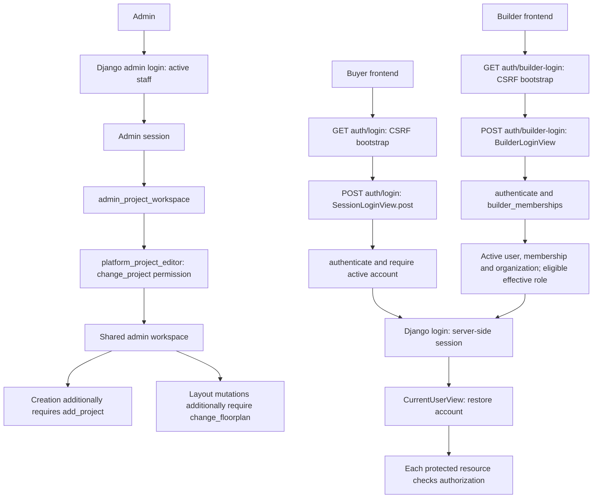

Admin workspace access does not require builder membership. Ordinary builder login still does. Buyer/builder logout uses `SessionLogoutView.post()`; protected API failures trigger private-state cleanup. Admin uses Django's admin logout flow.

References: [login handlers](../reailEstate/reailEstate_common/backend/platform_api/views.py), [builder access](../reailEstate/reailEstate_common/backend/platform_api/builder_access.py), [workspace permissions](../reailEstate/reailEstate_common/backend/platform_api/project_workspace.py), [frontend serving](../reailEstate/reailEstate_common/backend/config/service_frontend.py).

## 2. Project creation and editing — current

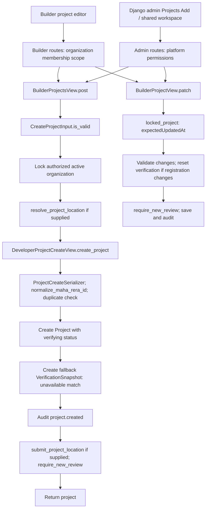

The shared creation path replaces the earlier diagram showing a separate inherited Django model-save path. Creation records a verification attempt, not verified registry success. The shared editor cannot directly set publication or verification status.

References: [shared route factory](../reailEstate/reailEstate_common/backend/platform_api/urls_project_workspace.py), [project handlers](../reailEstate/reailEstate_common/backend/platform_api/builder_views.py), [creation routine](../reailEstate/reailEstate_common/backend/platform_api/views.py).

## 3. Location, external sources and publication — current

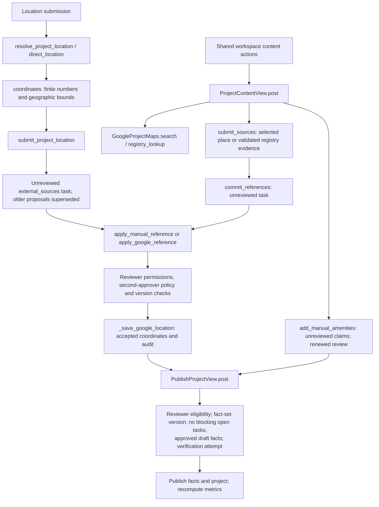

Search/lookup results do not become accepted locations automatically. Content mutations have request IDs and fingerprint checks; this is distinct from upload-completion idempotency. Builder location proposals always require a different approver. Other location references follow the configured policy. Registry evidence alone does not establish project-location identity.

References: [builder locations](../reailEstate/reailEstate_common/backend/platform_api/builder_locations.py), [content actions](../reailEstate/reailEstate_common/backend/platform_api/project_workspace_content.py), [external-source review](../reailEstate/reailEstate_common/backend/platform_api/external_sources_admin.py), [publication](../reailEstate/reailEstate_common/backend/platform_api/views.py).

## 4. Document upload — current, shared by builder and admin

```mermaid
sequenceDiagram
    actor User as Builder or authorized admin
    participant UI as Shared project frontend
    participant API as Workspace API handlers
    participant DB as Database
    participant FS as Artifact storage
    User->>UI: Select document
    UI->>UI: Generate upload UUID; calculate SHA-256
    UI->>API: POST documents:upload-intent
    Note over API: UploadIntentView.post: permissions, active project,<br/>filename, MIME, size, digest and duplicate checks
    API->>DB: EvidenceDocument.get_or_create(project, sha256)
    API-->>UI: Document ID and workspace-local uploadAction
    UI->>API: PUT documents/{id}/content
    Note over API: DocumentContentUploadView.put:<br/>verify bytes, digest and signature
    API->>FS: storage.save
    API->>DB: status = uploaded
    API-->>UI: 204
    UI->>API: POST documents/{id}:complete + Idempotency-Key
    API->>DB: Lock document; replay check; quarantine;<br/>_queue_document_processing + response record
    API-->>UI: 202 + Operation reference
    Note over DB: Workers consume the durable event independently
```

Builder prefix: `/api/v1`. Admin prefix: `/api/v1/admin/project-workspace`. The handlers and parser are shared; authorization and frontend route prefix differ. This replaces the earlier statement that admin lacked upload endpoints.

References: [workspace route adapter](../reailEstate/reailEstate_common/backend/platform_api/urls_project_workspace.py), [upload handlers](../reailEstate/reailEstate_common/backend/platform_api/views.py), [shared frontend](../reailEstate/reailEstate_common/frontend/src/BuilderPortal.tsx).

## 5. Upload-completion idempotency — current

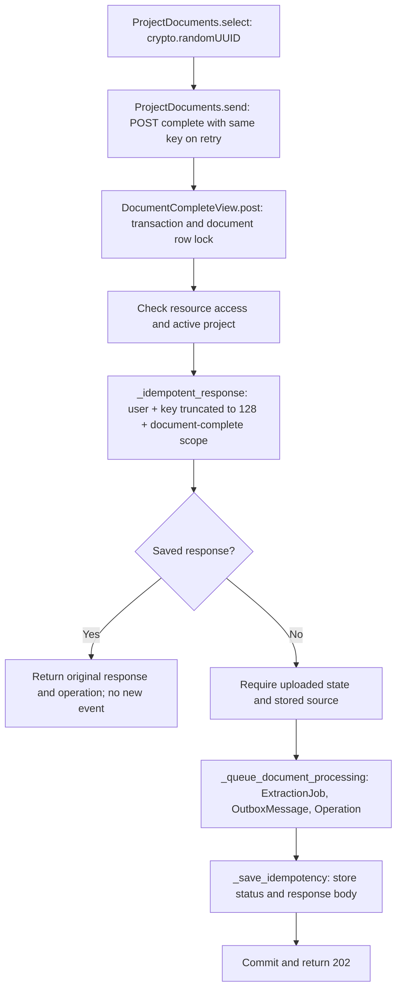

Only completion uses this header in the upload sequence. Intent uses project-plus-hash deduplication; PUT uses state and byte-integrity validation. The frontend key is in upload state, not durable across refresh. Upload completion does not compare payload fingerprints. A new intentional parse uses the separate reprocess action and scope.

References: [frontend key and requests](../reailEstate/reailEstate_common/frontend/src/BuilderPortal.tsx), [idempotency helpers](../reailEstate/reailEstate_common/backend/platform_api/views.py), [unique record constraint](../reailEstate/reailEstate_common/backend/platform_api/models.py).

## 6. Shared whole-document parser — current

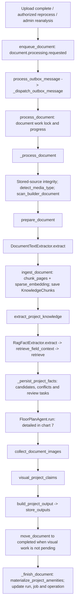

Builder/admin admission converges here. The chart shows the successful orchestration; failures update processing state and may be retried or held for provider availability. Local trusted-builder mode can skip a real malware scan with an audit record. Operation completion is not publication and can precede completion of separately queued child layout jobs.

References: [workers](../reailEstate/reailEstate_common/backend/platform_api/workers.py), [text/indexing](../reailEstate/reailEstate_common/backend/platform_api/rag.py), [facts](../reailEstate/reailEstate_common/backend/platform_api/business_ingestion.py), [scan policy](../reailEstate/reailEstate_common/backend/platform_api/builder_scan_policy.py).

## 7. PDF to saved floor-plan or layout image — current

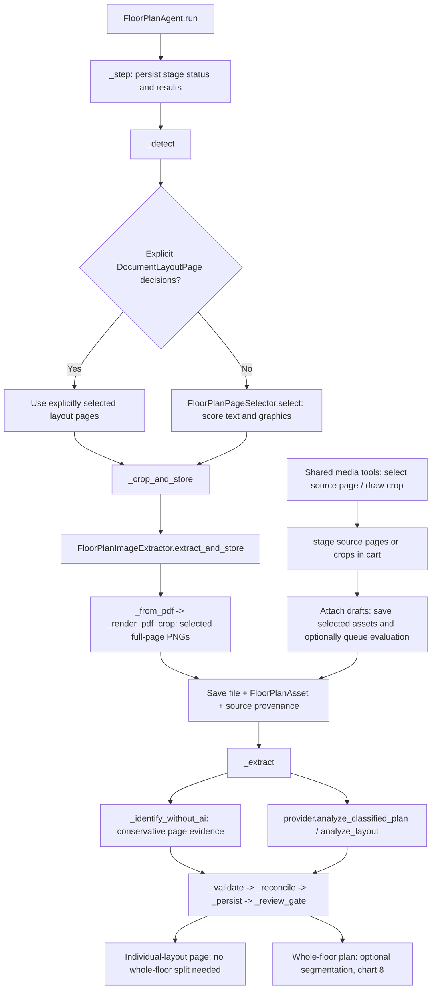

Script identification is not script unit segmentation. A single-flat page can proceed directly to layout analysis. Manual cart attachment is an explicit operation, not a side effect of previewing or saving a draft.

References: [agent](../reailEstate/reailEstate_common/backend/platform_api/floor_plan_agent.py), [page selector](../reailEstate/reailEstate_common/backend/platform_api/floor_plan_pages.py), [image extractor](../reailEstate/reailEstate_common/backend/platform_api/floor_plan_extractor.py), [crop cart](../reailEstate/reailEstate_common/backend/platform_api/crop_cart.py).

## 8. Whole-floor image to individual layouts — current

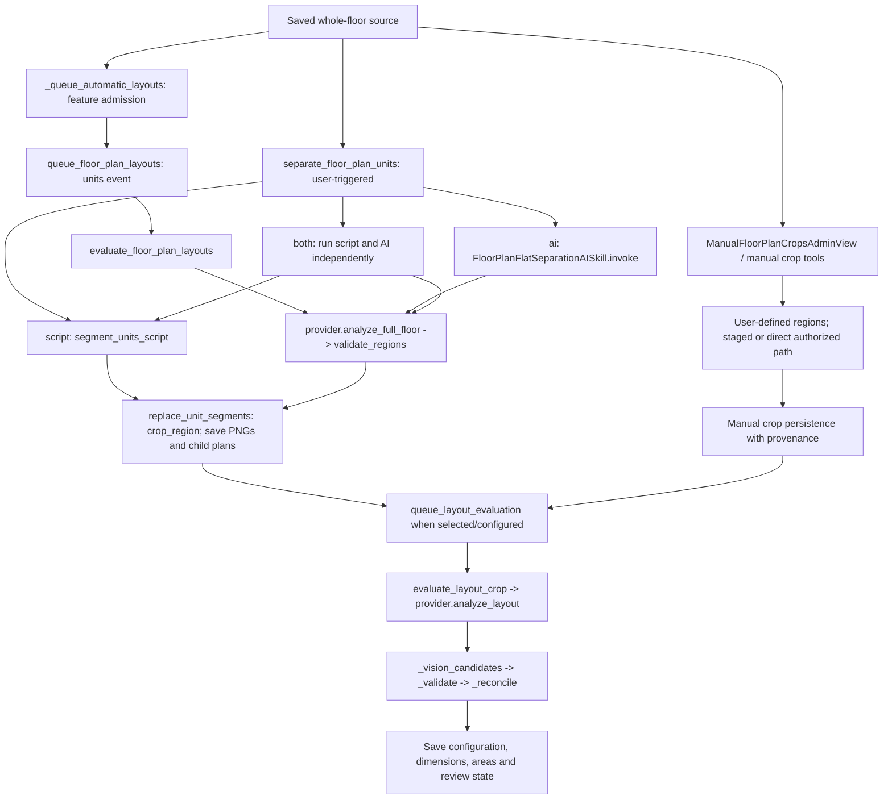

Automatic jobs and ad hoc separation have distinct orchestration. Both mode retains separate method results; it is not consensus merging. Segmentation finds boundaries; evaluation interprets the crop. Source images remain retained, and optional superseding is a separate guarded choice.

References: [automatic jobs](../reailEstate/reailEstate_common/backend/platform_api/floor_plan_layout_jobs.py), [ad hoc modes](../reailEstate/reailEstate_common/backend/platform_api/floor_plan_segmentation_service.py), [unit persistence](../reailEstate/reailEstate_common/backend/platform_api/unit_segmentation.py), [evaluation](../reailEstate/reailEstate_common/backend/platform_api/layout_reanalysis.py), [builder crop path](../reailEstate/reailEstate_common/backend/platform_api/builder_media.py).

## 9. Media files and parent relationships — current

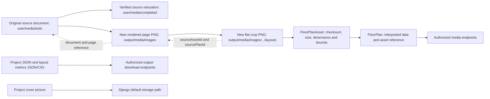

`RoutedStorage` routes `user/media/` and `output/media/` keys under `WORKSPACE_DATA_ROOT`; other keys use Django default storage. Cover pictures also use default storage, so describing that storage as only historical is incomplete. New files plus provenance are the current design; rendering a crop directly from original PDF coordinates remains a proposed quality improvement.

References: [storage routing](../reailEstate/reailEstate_common/backend/platform_api/artifact_storage.py), [asset records](../reailEstate/reailEstate_common/backend/platform_api/models.py), [project output files](../reailEstate/reailEstate_common/backend/platform_api/project_outputs.py), [media routes](../reailEstate/reailEstate_common/backend/platform_api/urls_media.py).

## 10. Queues, workers and failures — current

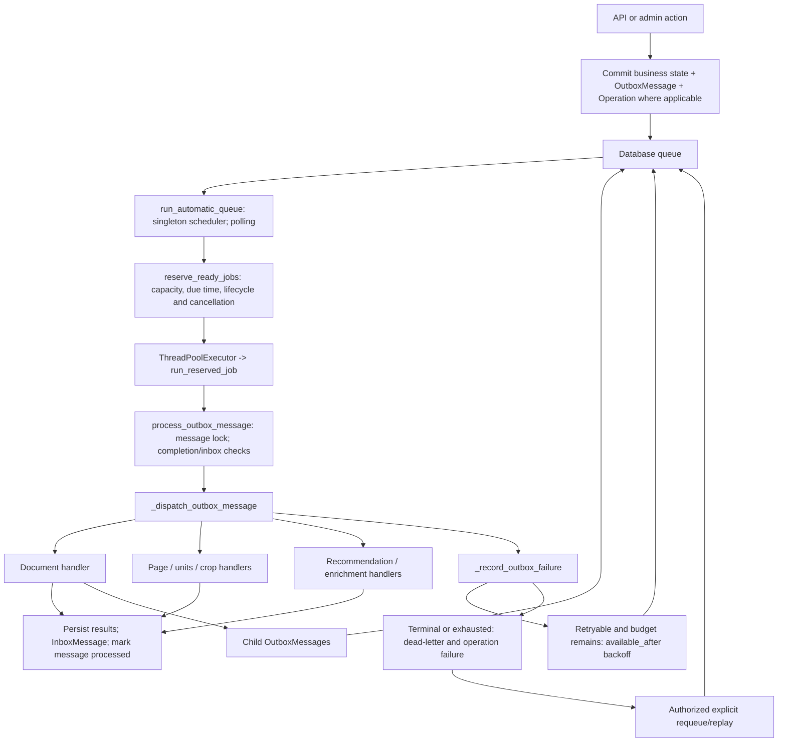

Worker heartbeats and progress are tracked separately; model calls have a shared concurrency budget. Default worker capacity is eight, capped at sixteen. Normal failure budget is three attempts; busy document locks defer without consuming an attempt. Durable rows and locks do not guarantee exactly-once external side effects. `published_at` currently acts as processing completion, not a separate broker-publish acknowledgement.

References: [automatic queue](../reailEstate/reailEstate_common/backend/platform_api/automatic_queue.py), [processing/retries](../reailEstate/reailEstate_common/backend/platform_api/workers.py), [locks/model slots](../reailEstate/reailEstate_common/backend/platform_api/ingestion_runtime.py), [monitoring](../reailEstate/reailEstate_common/backend/platform_api/queue_monitor.py).

## 11. Retrieval and OCR — current versus proposed

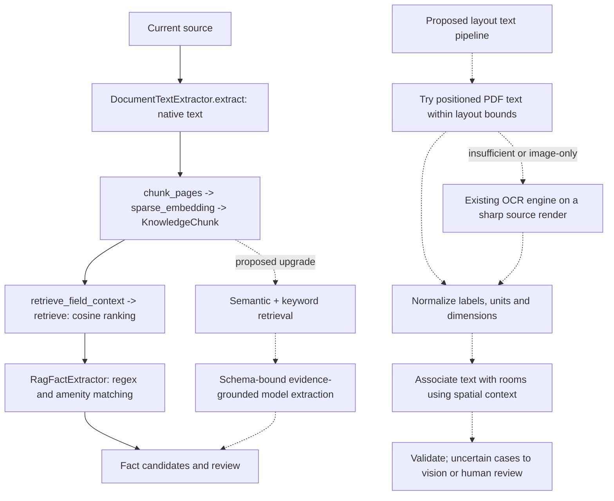

Solid arrows show the existing text-fact path. Dotted arrows show proposals, not implemented OCR or generative RAG. The current floor-plan vision path remains in chart 7/8. RAG can retrieve relevant evidence; it does not itself render pixels or reliably establish unit boundaries.

References: [current retrieval](../reailEstate/reailEstate_common/backend/platform_api/rag.py), [current fact extractor](../reailEstate/reailEstate_common/backend/platform_api/business_ingestion.py), [proposals](../todo.md).

## 12. Broker migration — proposed only

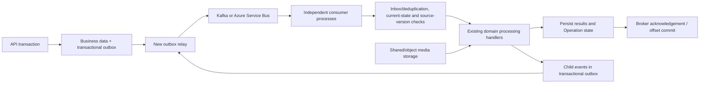

Keep stable event IDs, per-document coordination and application idempotency. Separate relay dispatch status from consumer completion. Coordinate retry ownership, and renew Service Bus locks or manage Kafka polling/offsets for long jobs. Do not send PDF/image bytes in messages. This diagram is a proposed migration, not the current deployment.

## Corrections to earlier diagrams

- Admin project creation now goes through the shared workspace and shared creation routine.
- Admin document uploads now use the shared three-step upload handlers under an admin prefix.
- Admin does not need builder membership for its authorized workspace.
- Shared content APIs now support source and amenity claim submission; review remains independent.
- Manual source-page/crop tools stage drafts before explicit attachment in the shared cart flow.
- Script page identification and script unit segmentation are distinct operations.
- Stored derived images retain provenance; original-PDF high-resolution crop regeneration is still proposed.
- Current text retrieval is not generative RAG, and dedicated OCR is proposed.
- Current queue is database-backed; the broker diagram remains future work.
