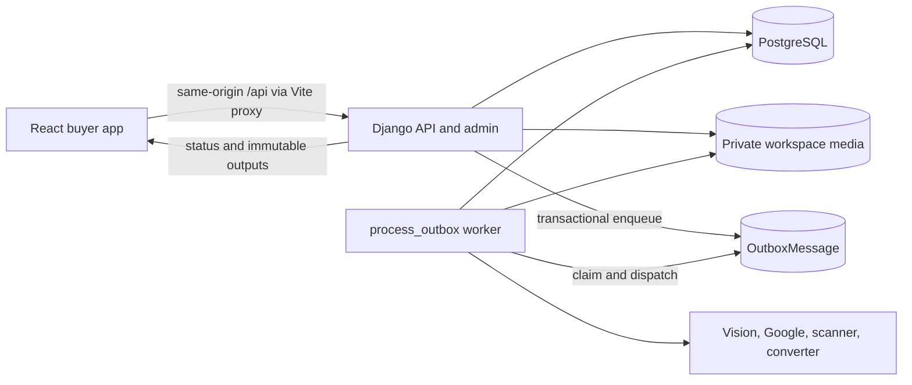
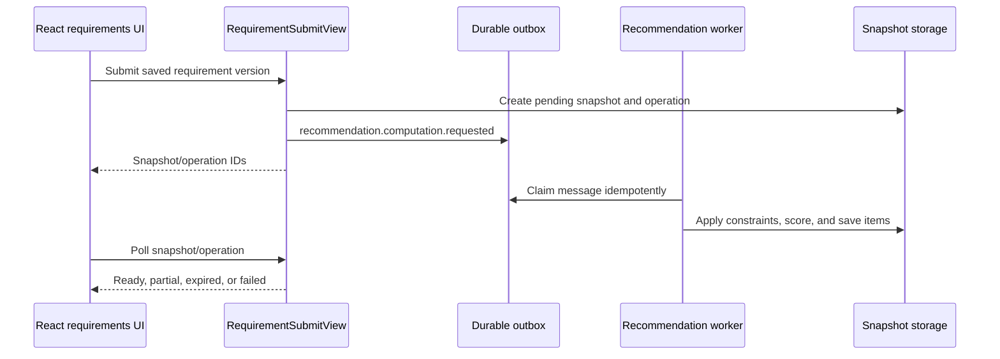

# Maintainer Guide

This is the current-state onboarding guide for the MMR real-estate service. The
implementation is a Django modular monolith with durable background work and a
React/Vite buyer application. The documents under [`../docs`](../docs/README.md)
remain the product and design baseline, but some still describe an earlier
ASP.NET proposal. For runtime behavior, prefer this guide, the service READMEs,
the URL configuration, and the tests.

Use [`../WORKFLOWS.md`](../WORKFLOWS.md) as the canonical workflow and runtime
catalogue. This guide explains implementation details and invariants rather than
duplicating lifecycle commands.

## Service map

| Area | Runtime owner | Primary source |
| --- | --- | --- |
| Buyer UI | React 19 and Vite | [`reailEstate_common/frontend/src`](reailEstate_common/frontend/src) |
| HTTP API and admin | Django and Django REST Framework | [`reailEstate_common/backend/platform_api/views.py`](reailEstate_common/backend/platform_api/views.py), [`reailEstate_common/backend/platform_api/admin.py`](reailEstate_common/backend/platform_api/admin.py) |
| API routing | Django URL configuration | [`reailEstate_common/backend/platform_api/urls.py`](reailEstate_common/backend/platform_api/urls.py) |
| Domain state | Django models and migrations | [`reailEstate_common/backend/platform_api/models.py`](reailEstate_common/backend/platform_api/models.py), [`reailEstate_common/backend/platform_api/migrations`](reailEstate_common/backend/platform_api/migrations) |
| Domain rules | Application services | [`reailEstate_common/backend/platform_api/services.py`](reailEstate_common/backend/platform_api/services.py) |
| Durable work | Outbox workers and queue monitor | [`reailEstate_common/backend/platform_api/workers.py`](reailEstate_common/backend/platform_api/workers.py), [`reailEstate_common/backend/platform_api/queue_monitor.py`](reailEstate_common/backend/platform_api/queue_monitor.py) |
| Document processing | Ingestion, conversion, vision, and output modules | [`reailEstate_common/backend/platform_api/business_ingestion.py`](reailEstate_common/backend/platform_api/business_ingestion.py), [`reailEstate_common/backend/platform_api/document_formats.py`](reailEstate_common/backend/platform_api/document_formats.py), [`reailEstate_common/backend/platform_api/project_outputs.py`](reailEstate_common/backend/platform_api/project_outputs.py) |
| External providers | Provider adapters and review integration | [`reailEstate_common/backend/platform_api/external_sources.py`](reailEstate_common/backend/platform_api/external_sources.py), [`reailEstate_common/backend/platform_api/external_sources_admin.py`](reailEstate_common/backend/platform_api/external_sources_admin.py) |
| Configuration | Environment-backed Django settings | [`reailEstate_common/backend/config/settings.py`](reailEstate_common/backend/config/settings.py) |
| Browser/API client | Same-origin fetch wrapper and route components | [`reailEstate_common/frontend/src/api.ts`](reailEstate_common/frontend/src/api.ts), [`reailEstate_common/frontend/src/App.tsx`](reailEstate_common/frontend/src/App.tsx) |

## Architecture at a glance



The HTTP request should validate, authorize, persist intent, and enqueue work.
Expensive extraction, image evaluation, and recommendation computation belong in
workers. Never move provider calls or large document processing into a request
just to make a screen appear synchronous.

## SOLID design and ownership

SOLID is a review discipline, not a certification or a reason to wrap every
function in a class. Prefer the existing modular-monolith boundaries and small
functions; introduce protocols only at genuine substitution points.

| Principle | Project rule | Existing implementation / verification |
| --- | --- | --- |
| Single responsibility | HTTP/admin adapters authorize and translate requests; services own use cases; commands parse options and print results; workers perform expensive work. | [`bulk_layout_evaluations.py`](reailEstate_common/backend/platform_api/bulk_layout_evaluations.py) separates batch selection/queueing from its command. |
| Open/closed | Extend provider implementations behind narrow contracts rather than adding provider branches throughout views. Keep new queue modes explicit. | [`integrations.py`](reailEstate_common/backend/platform_api/integrations.py) provider protocols; `EvaluationMode` defines batch intent. |
| Liskov substitution | Implementations preserve outcomes, exceptions, cleanup, privacy, and transaction semantics. Unavailable data is not a fabricated successful result. | Provider tests and [`test_layout_evaluation_queue.py`](reailEstate_common/backend/platform_api/tests/test_layout_evaluation_queue.py) check queue and worker contracts. |
| Interface segregation | Depend on only the operation a caller needs. Do not introduce a universal repository/provider interface. | [`google_route_batches.py`](reailEstate_common/backend/platform_api/google_route_batches.py) needs only a batch callback returning a report and attempted rows. |
| Dependency inversion | Leaf domain/policy code must not import adapters, models, or storage; infrastructure is supplied at orchestration boundaries. | [`test_domain_boundaries.py`](reailEstate_common/backend/platform_api/tests/test_domain_boundaries.py) verifies fresh imports, including the route batch orchestrator. |

Allowed direction is adapters -> application services -> domain/policy rules.
Infrastructure adapters implement the provider/storage contracts. Django ORM
access remains in application services where transactions are required; do not
add an extra repository layer solely for naming compliance. Frontend route
components own interaction state, [`buyer.ts`](reailEstate_common/frontend/src/buyer.ts) owns shared
buyer calculations/types, and [`api.ts`](reailEstate_common/frontend/src/api.ts) owns HTTP/session
mechanics. Keep these responsibilities separate as routes grow.

Preserve import paths and callable contracts when extracting existing code.
Compatibility exports are preferable to silently breaking callers. Characterize
behavior first, move one ownership boundary, run its tests, then widen checks.
Never weaken locking, authorization, idempotency, or approval gates to simplify a
refactor. A test that needs real transaction boundaries must use transactional
fixtures; do not remove the production guard against provider calls in transactions.

### Shared implementation ownership

- `realestate_common` owns dependency-light geometry, document extraction, image
  normalization, layout titles, room measurements, and atomic JSON checkpoints.
  The existing `platform_api.domain` imports remain compatibility exports.
- `config.service_settings.service_settings` defines service-role settings;
  the admin, builder, and buyer settings files apply this common overlay.
- `platform_api.api_common` owns the reusable no-store response policy.
- `platform_api.infrastructure.database_transfer` owns canonical record and field
  fingerprints for both database-transfer verification commands. Relation order
  is ignored; JSON array order and duplicate counts remain significant.
- Maintenance commands use `realestate_common.reports.write_json_report` and
  retain their original JSON encoding, strict-number, and retry choices.
- Generated frontend bundles belong under `reailEstate_common/frontend/dist`.
  Legacy bundles, test results, and temporary test files are excluded from Git.

### Architecture status and remaining work

The September 2026 consolidation is incremental, not a whole-project SOLID
completion claim. Large modules such as admin, views, workers, and the external
source review integration still combine multiple use cases. The route command's
per-project persistence loop also remains adapter-owned; only its multi-batch
policy has moved into an independent service. Preserve these compatibility
surfaces until the regression baseline is green.

Next gates, in order:

1. Triage the failing backend baseline below, distinguishing stale fixtures from
   production defects. Do not blanket-skip failures or merely relax assertions.
2. Extract individual media/admin use cases behind their current URLs, permission
   checks, audit events, and concurrency contracts.
3. Move route checkpoint/per-project orchestration out of management commands
   behind explicit report-store and provider dependencies, retaining report schema.
4. Split shared worker dispatch and large API modules by use case while retaining
   public imports, event names, and HTTP contracts.
5. Review frontend route state ownership, the existing effect warnings, and bundle
   splitting against the production browser suite before restructuring components.
6. Verify locking and concurrency on an isolated PostgreSQL test database before
   declaring a release regression-free. SQLite is not proof of PostgreSQL behavior.

## Core invariants

- Public catalogue responses default to `published` projects. Processing records
  are visible only through the explicit preview policy and must not leak private
  evidence, internal facts, or buyer data.
- Document upload, extraction, human review, location acceptance, registry
  verification, and publication are separate state transitions. Success in one
  does not imply approval in another.
- Generated claims are candidates until a reviewer resolves them. Extraction
  must not publish facts directly.
- Original documents and source images are immutable evidence. Corrections create
  derived assets, revisions, aliases, facts, and audit events.
- Recommendation snapshots are immutable and tied to requirement, catalogue, and
  fact-set versions. Recompute instead of rewriting a completed snapshot.
- Queue delivery is at least once. Producers and consumers must preserve
  idempotency, message deduplication, bounded retries, and dead-letter visibility.
- Exact buyer destinations, addresses, consent records, and account data are
  owner-scoped. Shared views redact precise location data.
- External provider results remain unreviewed until an authorized maintainer
  accepts them. Provider availability is not publication authority.
- Correlation IDs and audit events must follow mutations across HTTP, outbox, and
  worker boundaries.

## Important data flows

### 1. Request, session, CSRF, and correlation flow

1. The browser uses the wrapper in [`reailEstate_common/frontend/src/api.ts`](reailEstate_common/frontend/src/api.ts) so
   cookies, CSRF headers, timeouts, and session expiry behave consistently.
2. Vite proxies `/api` to Django on `127.0.0.1:8002`; production should preserve
   the same-origin session model.
3. Django session authentication establishes the account. Public endpoints opt
   into anonymous access explicitly; the default API posture is authenticated.
4. [`reailEstate_common/backend/platform_api/middleware.py`](reailEstate_common/backend/platform_api/middleware.py)
   accepts or creates a correlation ID and applies response protections.
5. Views enforce object ownership or role checks before serializers and services
   mutate state. Important mutations create `AuditEvent` records.

Primary endpoints include session login/logout/current-user, public catalogue,
account export, and account deletion under `/api/v1/`.

### 2. Public catalogue, project detail, gallery, and map flow

1. [`reailEstate_common/frontend/src/App.tsx`](reailEstate_common/frontend/src/App.tsx) and
   [`reailEstate_common/frontend/src/Browse.tsx`](reailEstate_common/frontend/src/Browse.tsx) request catalogue data.
2. `ProjectViewSet` filters published projects by locality, configuration, area,
   price, registry status, and amenities. `includeProcessing=true` follows the
   restricted processing-preview path.
3. List and detail serializers expose only the fields allowed for the caller and
   project state.
4. `ProjectGalleryView` selects visible floor plans and assets. Image bytes pass
   through the authenticated media view rather than a public storage directory.
5. [`reailEstate_common/frontend/src/ProjectGallery.tsx`](reailEstate_common/frontend/src/ProjectGallery.tsx) renders
   approved media and clearly labels any permitted unreviewed preview.
6. `MapStationListView` supplies local station layers to
   [`reailEstate_common/frontend/src/ProjectMap.tsx`](reailEstate_common/frontend/src/ProjectMap.tsx). The browser uses
   Leaflet/OpenStreetMap and does not call Google APIs.

Key records are `Project`, `Building`, `HomeConfiguration`, `ProjectAmenity`,
`ProjectFact`, `ProjectMetric`, `FloorPlan`, and `FloorPlanAsset`.

#### Listing picture selection

The media dashboard's `Project images` tab supports a `Project pic` upload and a
thumbnail radio picker under `Project pic from documents`. These controls are not
part of the project edit form. Selecting an extracted image verifies project
ownership, clean scan state, byte length and checksum, then saves a normalized PNG
as the explicit cover. Original evidence is unchanged. Choose one upload or one
document selection per save. The admin change history records the form change.

The `Project images` tab sits alongside Amenities, Floor plans and Layouts. Its upload/selection form saves
only the listing cover, requires project change permission, rejects stale edits
and retired projects, and records `project.picture_changed`. View-only users can
inspect the image choices but cannot save. The Layouts tab includes an image
carousel as well as its existing searchable layout directory and editing controls.

Without an explicit cover, the picture endpoint renders page 1 of the earliest
clean PDF and caches the derived image briefly by document ID and checksum.
Automatic document previews are public only when `PROJECT_PUBLIC_PREVIEW_ENABLED`
is enabled; otherwise an admin must select or upload the public cover. Selecting
`Automatic` clears the explicit cover and restores this fallback. Building
silhouettes are not inferred from the broad `general` category, which can also
include interiors; choose the appropriate building image from the thumbnails.

The `projectPic` API field feeds listing cards. Missing/unreadable images retain
the existing placeholder. See
[`reailEstate_common/backend/platform_api/project_pictures.py`](reailEstate_common/backend/platform_api/project_pictures.py)
for source validation and fallback rendering. Migration `0015` adds the cover field.

#### Project transit map

The project edit page includes a compact Google directions map with Metro and
Railway views. `project_transit_maps` uses the saved project coordinates and
saved station routes; it makes no provider API calls on page load. Each view
defaults to the shortest available saved walking distance, combining existing,
upcoming and unverified metro candidates. Upcoming stops retain their service-status label;
walking directions to a planned stop do not imply operating metro service.
When project coordinates are missing, a saved manual pin or a saved route origin
can be shown as a labelled preview without applying or approving it. Views without saved
routes show the pin map instead; missing pins show an empty state. Both link to
External sources for location and route review.
Google frames are allowed by CSP only on the project change page. The embed
receives route coordinates, not the server API key. Saved distances may differ
from Google's current displayed route, and are not a globally verified nearest
station claim.

Committing a new pin generates and saves nearby walking/driving routes when
`GOOGLE_MAPS_API_KEY` is configured. Existing draft routes are preserved without
another lookup. `Generate directions` on the project page refreshes routes from
the saved reference with a 5, 10 or 20 km search radius; manual pins do not require
a Google place ID or approval. These POST actions retain the location's review
state, check concurrent changes, and keep the pin if generation fails. Saved
route origins are used for the directions rather than substituting a different
approved location. Page loads never invoke paid lookup APIs.

Configure the backend environment with a server-side Google Maps key enabled for
Places API (New) and Routes API, then restart the backend. Do not place this key
in browser code or source control. Upcoming metro candidates additionally require
the authority-backed `PROJECT_METRO_CATALOGUE` / `PROJECT_METRO_CATALOGUE_FILE`;
Google's station search alone does not verify upcoming service.

Routing reads unverified candidates from the `platform_api_stationcandidate`
PostgreSQL table by default. Up to five nearby candidates are routed as a separate
unverified group. These candidates are not evidence of operational or upcoming
service. Route generation uses place IDs only when both
the building and station have valid IDs; otherwise both endpoints use coordinates.
The saved external directions link retains this choice. The compact embedded map
uses coordinates. Regenerate directions explicitly to refresh existing results.

##### Project fields and station choices

- Project status and verification status use Django `TextChoices`, rendered as
  dropdowns. Verification refers to the registry record, not location approval.
- The project form omits duplicate latitude/longitude inputs. Manage the pin under
   **External sources**: review it, confirm it, and use **Apply reviewed location**.
   This fills the stored coordinates through the audited approval path. Generating
  directions or selecting a station never approves the building pin. The configured
  second-reviewer policy still applies.
- The details page groups metadata at the top, reference/media links and route
   controls on the left, and the transit map on the right. Address and locality
   follow beneath them. These sections stack on mobile; existing coordinates are
   preserved when saving the form.
- Under **External sources > Saved station directions**, select one **Railway
  station** and one **Metro station**, then **Save displayed stations**. The Metro
  selector combines all three metro groups. Each selector can instead use
  **Automatic (shortest available walking route)**. A station with no returned
  walking distance can be explicitly chosen, but no distance is invented.
- Choices are saved in `platform_api_project.transit_station_choices` and audited.
  They survive refresh when the station identity and coordinates still match. If
  a chosen station is absent from refreshed results, the display falls back to
  the shortest available route. Re-select after a coordinate correction. Saving
  checks the project version and route snapshot to reject stale submissions.

##### Station catalogue and corrections queue

1. Apply migrations and import the original CSV once, from the workspace root:

   ```powershell
   $env:DATABASE_BACKEND = 'postgresql'
   & './reailEstate/reailEstate_common/backend/.venv/Scripts/python.exe' './reailEstate/reailEstate_common/backend/manage.py' migrate
   & './reailEstate/reailEstate_common/backend/.venv/Scripts/python.exe' './reailEstate/reailEstate_common/backend/manage.py' import_station_candidates './reailEstate/reailEstate_common/backend/config/mmr-metro-candidates.csv'
   ```

2. Open **Active queue > Station corrections**, or the **Station corrections
   queue** sidebar link. Repeated equal coordinates are deduplicated; conflicting
   or invalid coordinates produce `needs_review=true` rows excluded from routing.
   `issue` explains the correction, and `coordinate_options` preserves submitted
   alternatives. Re-importing never overwrites existing database edits.
3. In **Station candidates**, set the correct `latitude` and `longitude`, retain
   `active=true`, clear `needs_review`, and clear the resolved `issue`. `sequence`
   orders schematic lines; inactive or unresolved rows break those lines. Changing
   coordinates does not verify service status or station access.
4. A PostgreSQL database viewer may edit the same table directly. Connect to the
   configured application database (locally `realestate`, port `15432`), using
   credentials from the ignored local configuration, not copied into documentation.
   Select the row by UUID; edit both coordinates together, `needs_review`, `issue`,
   and `updated_at`. Do not change its UUID or overwrite `coordinate_options`.
   Database constraints enforce coordinate ranges and require coordinates when
   `needs_review=false`. Direct SQL bypasses Django admin audit logging; prefer
   the admin editor or keep a separate change record.
5. Reload the buyer map to see current catalogue positions. For each affected
   project, use **Generate directions** to refresh saved distances and endpoints,
   then confirm the displayed-station choices. Existing route snapshots are not
   silently rewritten, and no paid API call occurs just from editing a station.

The initial import leaves six conflicts: **BSNL Metro, Diamond Garden, Mandale,
Mankhurd, Shivaji Chowk** (Line 2B), and **Pandurang Wadi** (Line 9). An admin must
check the actual station pin and choose or replace the listed coordinate pairs.
These issues belong to the corrections queue, not the project's route-error panel.

`PROJECT_MAP_STATION_CANDIDATES_FILE` is now empty by default. Setting it explicitly
enables the legacy CSV read path and bypasses database candidates; leave it unset
for database editing. Authority-backed service evidence continues to use the
separate metro catalogue configuration.

### 3. Buyer requirement profile flow

1. [`reailEstate_common/frontend/src/Requirements.tsx`](reailEstate_common/frontend/src/Requirements.tsx) maintains the
   canonical guided/summary draft. Sensitive guest budget and destination values
   remain in memory; only limited draft state uses session storage.
2. `RequirementProfileViewSet` creates or updates the account-owned profile.
3. `validate_requirement_payload` in
   [`reailEstate_common/backend/platform_api/services.py`](reailEstate_common/backend/platform_api/services.py) validates
   places, coordinates, home constraints, budget, commute, and scoring weights.
4. Every save creates an immutable `RequirementVersion`; `If-Match` prevents a
   stale client from overwriting a newer version.
5. `ConsentViewSet` records consent independently. Submission requires active
   consent and a complete, valid saved version.

Do not collapse the mutable profile pointer and immutable versions into one row;
version identity is required by recommendation reproducibility and sharing.

### 4. Recommendation flow



`compute_recommendations` applies hard constraints first, then weighted commute,
budget, home, amenity, and evidence components. Results persist as
`RecommendationSnapshot` and `RecommendationItem` records with catalogue and
fact-set versions. Worker dispatch lives in
[`reailEstate_common/backend/platform_api/workers.py`](reailEstate_common/backend/platform_api/workers.py).

### 5. Shortlist, comparison, and share flow

1. Authenticated buyers add or remove published projects through
   `ShortlistViewSet` and `ShortlistProjectView`.
2. `ProjectComparisonView` accepts two to four published project IDs and returns
   caller-visible facts only.
3. Requirement/comparison shares use expiring, revocable tokens. Stored tokens
   are hashed, and shared requirement output redacts exact addresses and
   coordinates.
4. Withdrawn or otherwise ineligible projects must disappear from newly rendered
   buyer collections without exposing historical private state.

### 6. Developer project and document upload flow

1. `DeveloperProjectCreateView` verifies organization membership, normalizes the
   registry identifier, rejects duplicates, and creates the project plus an
   initial verification snapshot.
2. `UploadIntentView` authorizes a project editor and validates the proposed file
   metadata before allocating a private upload.
3. `DocumentContentUploadView` writes the file under the workspace `todo` area.
   It verifies size, declared type, extension, signature, and SHA-256.
4. `DocumentCompleteView` idempotently creates an `EvidenceDocument`,
   `ExtractionJob`, `Operation`, and document-processing outbox event.
5. The response reports accepted/pending state; it does not run extraction in the
   HTTP request.

Private storage layout, supported formats, and output contracts are detailed in
[`../docs/11-document-ingestion-and-project-outputs.md`](../docs/11-document-ingestion-and-project-outputs.md).

### 7. Document extraction and structured output flow

1. A `process_outbox` worker claims the document event and records inbox/message
   state so duplicate delivery is harmless.
2. `process_document` verifies integrity, invokes the configured malware scanner,
   and optionally converts supported Office documents.
3. [`reailEstate_common/backend/platform_api/rag.py`](reailEstate_common/backend/platform_api/rag.py) and the ingestion
   modules extract text, chunks, pages, and images.
4. Floor-plan and project-vision modules derive bounded structured candidates;
   provider responses retain model/profile/checksum provenance.
5. The worker persists `KnowledgeChunk`, `FloorPlanAsset`, `FloorPlan`,
   `FactCandidate`, `FactConflict`, workflow/run records, and review tasks.
6. [`reailEstate_common/backend/platform_api/project_outputs.py`](reailEstate_common/backend/platform_api/project_outputs.py)
   materializes typed project reports. Output download views expose only
   authorized artifacts.
7. Successful originals move from `todo` to `completed`; rejected/quarantined
   files follow retention policy. No generated candidate is public by default.

### 8. Manual media, crop, and layout evaluation flow

1. A project editor or staff reviewer opens the Django project media dashboard.
2. Whole-page additions, unit segmentation, manual crops, rotations, aliases,
   removals, replacements, and existing-layout updates use the APIs in
   [`reailEstate_common/backend/platform_api/views.py`](reailEstate_common/backend/platform_api/views.py) and admin
   integration in [`reailEstate_common/backend/platform_api/admin.py`](reailEstate_common/backend/platform_api/admin.py).
3. Crop/page edits first create private drafts. Explicit commit rechecks source
   checksums and target versions, creates immutable derived assets, records an
   audit event, and enqueues evaluation.
4. Events such as `source.page_evaluation.requested`,
   `floor_plan.units_evaluation.requested`, and
   `floor_plan.crop_evaluation.requested` are dispatched by the common worker.
5. Evaluation writes checksum-bound facts and statuses. Failed work remains
   visible and requires an explicit retry; cancelled work is not silently revived.
6. Human approval/correction/rejection through `ResolveFloorPlanView` determines
   whether a layout can contribute a reviewed project fact.

See [`reailEstate_common/backend/SKILLS.md`](reailEstate_common/backend/SKILLS.md) for the detailed, review-gated media
operations. Source assets and provenance must survive every correction.

Vision providers may cache credentials and tokens across page/document calls.
The creator owns cleanup: document processing, the standalone floor-plan agent,
and the one-shot flat-separation skill close their own providers in `finally`.
Injected providers remain owned by the caller so concurrent/batch ingestion can
reuse them until the batch ends. Do not restore per-request credential disposal
or reduce extraction budgets to satisfy older tests.

The crop editor heading includes the resolved source floor plan's display name,
escaped by the template. The Floor plans tab supports natural name sorting in
both directions with active plans first; toggling active state maintains grouping.
Room-size corrections use **Manually update room sizes**, preserving provenance
and review state rather than editing extraction JSON through a shell.

### Supported evaluation operations

Use application entry points instead of one-off database mutation snippets:

| Intent | Supported entry point | State guarantees |
| --- | --- | --- |
| Consume pending project work | **Run queued evaluations (exclude DLQ)** or `process_outbox --event-type extraction --project-id <UUID> --drain` | No historical-failure warning; excludes completed and dead-letter jobs. Normal scheduled retries are eligible. |
| Inspect historical failures before consuming pending work | **Review failures and run queued evaluations** | Confirmation does not itself requeue DLQ entries. |
| Retry a stopped job | **Evaluation jobs** / project-filtered failed-jobs link, then explicit requeue | Version checked, permission checked, audited; cancelled/ineligible work remains protected. |
| Correct a layout | Crop/update editor or room-size editor | Source evidence retained; optimistic concurrency and audit enforced. |
| Enqueue saved layouts in bulk | `requeue_all_layout_evaluations` | Preview by default; execution only in local/development; optional project scope and limit. |

Bulk enqueue and worker execution are separate. From `reailEstate/reailEstate_common/backend`:

```powershell
& $Python manage.py requeue_all_layout_evaluations --project-id <UUID> --mode new --limit 20
& $Python manage.py requeue_all_layout_evaluations --project-id <UUID> --mode new --limit 20 --execute
```

`new` preserves existing pending/running/completed/failed/cancelled jobs for the
same asset; it queues missing evaluations and reuses existing jobs. It is not a
filter on historical attempt counts. `retry-failed` additionally rearms failures;
`force` additionally creates fresh work for completed results. Neither revives
cancelled jobs. The command retains **force as its legacy default**: always spell
out `--mode` in new automation. The reusable service defaults to `new`.
`queued` counts eligible pending work, including reused pending jobs, not just new
database rows. No enqueue mode performs model calls or publishes facts.

### 9. Fact review and project publication flow

1. `DeveloperSubmitReviewView` requires processing attestation, a verification
   attempt, and uploaded evidence before moving a project to `needs_review` and
   creating publication review work.
2. `ReviewTaskViewSet` exposes role-scoped tasks. `ResolveReviewTaskView` selects a
   candidate or records a corrected value, resolves conflicts, advances the task
   version, and creates a new draft fact set.
3. Layout review remains independent and uses `ResolveFloorPlanView`.
4. `PublishProjectView` prevents self-approval, verifies the expected fact-set
   version, rejects blocking open tasks, and requires verification evidence plus
   approved facts.
5. Publication atomically promotes the approved fact set, computes metrics,
   records audit data, and changes the project to `published`.
6. Public catalogue queries can now return the project. Publication never makes
   raw documents or internal review evidence public.

### 10. External source and location flow

All external data enters as reviewable evidence, not trusted project truth.

- **MahaRERA:** `fetch_maharera_project` uses the adapter in
  [`reailEstate_common/backend/platform_api/external_sources.py`](reailEstate_common/backend/platform_api/external_sources.py).
  CAPTCHA steps remain manual; maintainers must not add bypass behavior.
- **Google Places matching:** `refresh_google_project_places` previews strict
  name/locality matches. `--execute` requires `GOOGLE_MAPS_API_KEY`, checkpoints
  progress, and creates unreviewed references. It does not accept coordinates or
  publish projects.
- **Manual place decisions:** `import_google_project_place_decisions` imports
  target-bound reviewed decisions. Direct coordinates and validated share links
  use the separate direct-location path.
- **Routes and stations:** `enrich_google_project_routes --prefetch-only` accepts
   saved Google references or manual pins, obtains and persists routes without
   approving the pin or updating project coordinates. Omitting `--prefetch-only`
   opts into the legacy reviewed-location acceptance workflow and its authorization
   rules. `available`, `no_route`, and provider `unavailable` are distinct outcomes.
- **Frontend map:** accepted project coordinates and the local station catalogue
  reach the browser through Django. Provider keys and raw provider workflows never
  reach React.

The route command is implemented in
[`reailEstate_common/backend/platform_api/management/commands/enrich_google_project_routes.py`](reailEstate_common/backend/platform_api/management/commands/enrich_google_project_routes.py).

`--drain` runs up to `--max-batches` (default/maximum 100), with 1-5 projects per
batch. Python owns the loop, holds the checkpoint lock across the drain, and stops
before another batch if newly attempted first-batch rows contain no available
duration. The attempted rows, not old successes in the report, determine this
safety check. Every batch checkpoints before continuing. Provider errors remain
in the report; console output does not echo raw provider errors.

[`run_google_routes_all.ps1`](reailEstate_common/backend/run_google_routes_all.ps1) is a compatibility
launcher for environment selection, arguments and log redirection, not a second
implementation of the batch policy. It defaults to non-approving prefetch and
passes `--drain`. Its `-ApproveLocations` switch remains an explicit opt-in.
Do not run an old launcher concurrently with the new command. An interruption can
leave a database update ahead of the checkpoint; inspect state before resuming.

Portable command equivalent, after configuring the provider key privately:

```powershell
& $Python manage.py enrich_google_project_routes --execute --prefetch-only --drain --reviewer <username>
```

Add `--resume` only when the report already exists. Use `--report` for a separate
checkpoint, and `--retry-failed --retry-generation <stable-id>` for one explicit
retry generation. Preview (omit `--execute`) performs no provider calls.

### 11. Account privacy, export, and deletion flow

1. Consent is versioned and audited separately from requirement content.
2. `GET /api/v1/account:export` collects the authenticated account's portable
   profile, consent, requirement, shortlist, and related account data.
3. `POST /api/v1/account:delete` follows the configured deletion/anonymization
   boundary while preserving records that must remain for security or audit.
4. Shares are revoked or made unusable, and owner-scoped endpoints must stop
   returning deleted account data.
5. Logs, analytics, and new integrations must not capture precise destinations,
   raw documents, session secrets, API keys, or share tokens.

Review [`../docs/07-security-privacy-threat-model.md`](../docs/07-security-privacy-threat-model.md)
before changing authentication, content rendering, uploads, outbound HTTP,
provider origins, publication rules, retention, or personal-data use.

### 12. Queue, status, audit, and health flow

1. A state-changing request creates domain records and an `OutboxMessage` in the
   same transaction.
2. `process_outbox` claims eligible messages and records `QueueWorker` identity,
   capacity, heartbeat, current work, and progress.
3. `InboxMessage`/idempotency records prevent duplicate side effects. Failures use
   bounded retries and then remain inspectable as dead letters.
4. `Operation` gives the UI a stable status resource independent of the worker
   process. `AuditEvent` records who changed important domain state and why.
5. Maintainers inspect `/health/live`, `/health/ready`, admin integration health,
   operational metrics, audit events, queue workers, retries, and dead letters.

Do not infer worker health from a process ID alone on Windows. Use the durable
worker UUID and heartbeat recorded by the queue monitor.

## Local development

Use the canonical lifecycle commands in
[`../WORKFLOWS.md`](../WORKFLOWS.md#2-local-service-lifecycle):

```powershell
.\reailEstate\manage_services.ps1 -Action start
.\reailEstate\manage_services.ps1 -Action status
.\reailEstate\manage_services.ps1 -Action stop
```

The application runtime uses PostgreSQL. SQLite is limited to isolated test
configuration and must not be used for application or corpus-writing workflows.
The persistent `run_extraction_dispatcher` process owns normal document, media,
and recommendation execution. Use `process_outbox` only for bounded diagnostics
or deliberate maintenance, as catalogued in `WORKFLOWS.md`.

The bundled metro JSON is currently empty and must not be enabled as an authority
catalogue. Do not fabricate authority data to satisfy a test. A service launched
with `--noreload` must be restarted after Python or template updates.

## Configuration groups

| Concern | Important environment variables |
| --- | --- |
| Database | `DATABASE_BACKEND`, `PGDATABASE`, `PGUSER`, `PGPASSWORD`, `PGHOST`, `PGPORT`, `PGSSLMODE` |
| Django/security | `DJANGO_SECRET_KEY`, `DJANGO_DEBUG`, `DJANGO_ALLOWED_HOSTS`, `CSRF_TRUSTED_ORIGINS`, `SECURE_SSL_REDIRECT` |
| Workspace/files | `WORKSPACE_DATA_ROOT`, `MAX_UPLOAD_BYTES`, `REJECTED_UPLOAD_RETENTION_DAYS` |
| Extraction | `FLOOR_PLAN_EXTRACTION_MODE`, `FLOOR_PLAN_VISION_PROFILES_FILE`, `VISION_MAX_CONCURRENT_REQUESTS`, `INGESTION_MAX_WORKERS`; providers and fallback order live in `vision-profiles.json` |
| Scanning/conversion | `DOCUMENT_SCANNER`, `CLAMAV_EXECUTABLE`, `OFFICE_CONVERTER_ENABLED`, `OFFICE_CONVERTER_EXECUTABLE` |
| External data | `GOOGLE_MAPS_API_KEY`, `PROJECT_ENRICHMENT_BACKEND`, `PROJECT_METRO_CATALOGUE_FILE`, `PROJECT_MAP_STATION_CANDIDATES_FILE` |
| Visibility | `PROJECT_PUBLIC_PREVIEW_ENABLED`, `PROJECT_LOCATION_REQUIRE_SECOND_APPROVER` |
| Routing | `ROUTING_PROVIDER`, `ROUTING_CACHE_SECONDS`, `DEFAULT_COMMUTE_TOLERANCE_MINUTES` |
| Telemetry | `ENVIRONMENT`, `OTEL_ENABLED`, `OTEL_SERVICE_NAME`, `OTEL_EXPORTER_ENDPOINT` |

Never commit provider credentials or local profile files. `PROJECT_PUBLIC_PREVIEW_ENABLED`
is a local/debug convenience and must be reviewed explicitly for any shared or
production environment.

## Regression gates

From the workspace root, use an isolated test database and mocked providers. Do
not invoke corpus commands or live worker launches as tests. Existing fixtures
isolate media outputs under temporary directories.

```powershell
$Python = (Resolve-Path './reailEstate/reailEstate_common/backend/.venv/Scripts/python.exe').Path
$env:DATABASE_BACKEND = 'sqlite'
$env:PROJECT_METRO_CATALOGUE_FILE = ''
& $Python -m pytest -c ./reailEstate/reailEstate_common/backend/pytest.ini ./reailEstate/reailEstate_common/backend/platform_api/tests --tb=short
npm --prefix reailEstate/reailEstate_common/frontend test
npm --prefix reailEstate/reailEstate_common/frontend run lint
npm --prefix reailEstate/reailEstate_common/frontend run build
$env:BUYER_TEST_BUILD = 'preview'
npm --prefix reailEstate/reailEstate_common/frontend run test:e2e
```

Check each command's exit code; do not treat silence or later successful commands
as proof of success. Use a dedicated terminal or restore environment variables
before restarting the live backend. Browser tests own port 5175 and refuse to
reuse an existing server. They mock API responses; they do not prove live backend
integration. PostgreSQL checks must use a separate disposable test database.

### Verification snapshot: 2026-09-19

- Consolidation-focused backend suite: **122 passed**.
- Full isolated SQLite suite: **1,273 passed, 39 failed, 7 skipped** with 341
  warnings. The remaining failures cluster around processing-coordinate preview
  policy, builder media/crop fixtures, queue-monitor actions, one domain-boundary
  assertion, and the intentionally empty authority catalogue.
- A PostgreSQL-configured full run completed with **1,261 passed, 56 failed,
  2 skipped**. Additional failures included tests that close or replace database
  connections and vision-client fixture mismatches. PostgreSQL is the application
  runtime, but the full test baseline remains red and is not a release gate yet.
- Frontend unit tests: **18 passed**. Full Playwright suite: **104 passed**.
  Buyer and builder production bundles built successfully. Lint completed with
  warnings and no errors.
- `git diff --check` and PowerShell syntax checks passed. The unified lifecycle
  smoke test applied migrations, started the three HTTP services and worker,
  passed live/readiness checks, and stopped every managed process.
- No live evaluations, paid provider calls, cloud applies, image pushes, or cloud
  migrations were performed.

Do not declare the whole project SOLID-compliant or regression-free while these
gates remain red. Resolve each at its owning boundary with a focused reproduction,
then rerun the complete suite before continuing broad structural moves.

### Cleanup verification: 2026-10-05

- Focused backend suite: **205 passed, 21 failed**. The same 21 failing tests
  reproduced against an isolated copy of the original revision: builder-media
  fixtures (18), feature-flag expectations (2), and the crop-policy import boundary
  (1). The other focused tests, including five new common-helper regressions,
  passed. This was not a full-suite or PostgreSQL validation.
- All three Django service startup checks passed. Buyer and builder production
  bundles built successfully; frontend unit tests: **18 passed**. Lint completed
  with existing React warnings and no errors. `git diff --check` passed.

### Roles, themes and public beta: 2026-10-05

- New organization role templates and atomic bulk onboarding use the shared builder
  authorization boundary. Apply migration `0020_reusable_organization_roles` before
  serving the updated builder/admin controls. Platform roles reuse Django groups.
- Buyer and builder themes use semantic CSS tokens and persist light/dark/system
  preference. Admin retains Django's native theme control.
- The unsigned beta run ranks published catalogue facts in the browser and stores
  query/results in consented cookies for 90 days; no anonymous server profile or job
  is created. The browser-level one-run limit survives in-app deletion, but cookie
  clearing resets it. Full commute/evidence scoring requires sign-in.
- Focused role/builder/service-boundary backend checks on isolated SQLite: **69 passed**,
  including CSRF enforcement and assigned-template access protection. Frontend unit
  tests: **24 passed**. Buyer/builder production builds pass; lint has existing React
  warnings. Playwright CLI smoke checks use intercepted synthetic APIs to verify
  guest restore/shortlist persistence and deletion, second-run sign-in, and builder bulk onboarding
  on desktop and mobile. These are focused checks, not a full-suite release gate.

## Change checklist

Before changing a flow, identify:

1. The owning view/service and authorization boundary.
2. The domain records and immutable evidence affected.
3. Whether work belongs in HTTP or in the durable outbox.
4. Idempotency behavior for retries and duplicate requests/messages.
5. Audit, correlation, operation-status, and failure visibility.
6. Public serialization and privacy impact.
7. Migration, rollback, and compatibility needs.
8. The narrowest backend and frontend tests that prove the behavior.

Useful references are [`reailEstate_common/backend/README.md`](reailEstate_common/backend/README.md),
[`reailEstate_common/frontend/README.md`](reailEstate_common/frontend/README.md),
[`../docs/05-api-contracts.md`](../docs/05-api-contracts.md), and
[`../docs/06-data-model.md`](../docs/06-data-model.md).

## Known documentation drift

- [`../docs/README.md`](../docs/README.md) and parts of the backlog still call
  ASP.NET Core the proposed backend. The running backend is Django/Python.
- Product, HLD, LLD, API, UX, security, and rollout documents are requirements and
  design baselines; wording about future work does not prove a feature is absent.
- Implementation truth is concentrated in Django settings, URLs, views, services,
  workers, migrations, tests, the backend README, and the frontend README.
- Keep this file current when adding a new queue event, trust boundary, public
  serializer, external provider, storage lifecycle, or publication gate.
