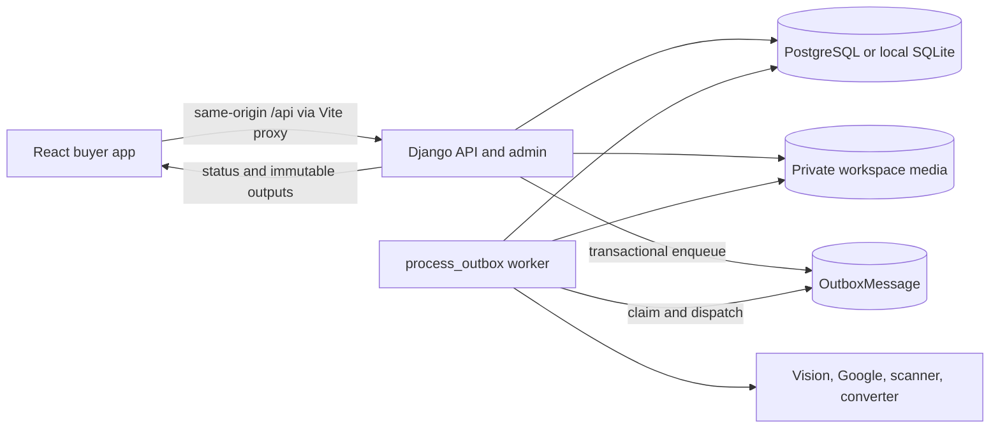
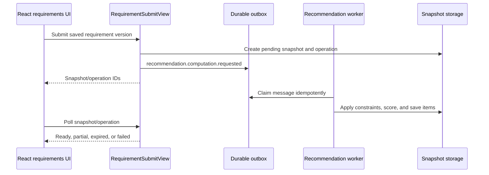

# Maintainer Guide

This is the current-state onboarding guide for the MMR real-estate service. The
implementation is a Django modular monolith with durable background work and a
React/Vite buyer application. The documents under [`../docs`](../docs/README.md)
remain the product and design baseline, but some still describe an earlier
ASP.NET proposal. For runtime behavior, prefer this guide, the service READMEs,
the URL configuration, and the tests.

## Service map

| Area | Runtime owner | Primary source |
| --- | --- | --- |
| Buyer UI | React 19 and Vite | [`frontend/src`](frontend/src) |
| HTTP API and admin | Django and Django REST Framework | [`backend/platform_api/views.py`](backend/platform_api/views.py), [`backend/platform_api/admin.py`](backend/platform_api/admin.py) |
| API routing | Django URL configuration | [`backend/platform_api/urls.py`](backend/platform_api/urls.py) |
| Domain state | Django models and migrations | [`backend/platform_api/models.py`](backend/platform_api/models.py), [`backend/platform_api/migrations`](backend/platform_api/migrations) |
| Domain rules | Application services | [`backend/platform_api/services.py`](backend/platform_api/services.py) |
| Durable work | Outbox workers and queue monitor | [`backend/platform_api/workers.py`](backend/platform_api/workers.py), [`backend/platform_api/queue_monitor.py`](backend/platform_api/queue_monitor.py) |
| Document processing | Ingestion, conversion, vision, and output modules | [`backend/platform_api/business_ingestion.py`](backend/platform_api/business_ingestion.py), [`backend/platform_api/document_formats.py`](backend/platform_api/document_formats.py), [`backend/platform_api/project_outputs.py`](backend/platform_api/project_outputs.py) |
| External providers | Provider adapters and review integration | [`backend/platform_api/external_sources.py`](backend/platform_api/external_sources.py), [`backend/platform_api/external_sources_admin.py`](backend/platform_api/external_sources_admin.py) |
| Configuration | Environment-backed Django settings | [`backend/config/settings.py`](backend/config/settings.py) |
| Browser/API client | Same-origin fetch wrapper and route components | [`frontend/src/api.ts`](frontend/src/api.ts), [`frontend/src/App.tsx`](frontend/src/App.tsx) |

## Architecture at a glance



The HTTP request should validate, authorize, persist intent, and enqueue work.
Expensive extraction, image evaluation, and recommendation computation belong in
workers. Never move provider calls or large document processing into a request
just to make a screen appear synchronous.

## Core invariants

- Public catalogue responses default to `published` projects. Processing records
  are visible only through the explicit preview policy and must not leak private
  evidence, internal facts, or buyer data.
- Document upload, extraction, human review, location acceptance, registry
  verification, and publication are separate state transitions. Success in one
  does not imply approval in another.
- Generated claims are candidates until a reviewer resolves them. Extraction
  must not publish facts directly.
- Original documents and source images are immutable evidence. Corrections create
  derived assets, revisions, aliases, facts, and audit events.
- Recommendation snapshots are immutable and tied to requirement, catalogue, and
  fact-set versions. Recompute instead of rewriting a completed snapshot.
- Queue delivery is at least once. Producers and consumers must preserve
  idempotency, message deduplication, bounded retries, and dead-letter visibility.
- Exact buyer destinations, addresses, consent records, and account data are
  owner-scoped. Shared views redact precise location data.
- External provider results remain unreviewed until an authorized maintainer
  accepts them. Provider availability is not publication authority.
- Correlation IDs and audit events must follow mutations across HTTP, outbox, and
  worker boundaries.

## Important data flows

### 1. Request, session, CSRF, and correlation flow

1. The browser uses the wrapper in [`frontend/src/api.ts`](frontend/src/api.ts) so
   cookies, CSRF headers, timeouts, and session expiry behave consistently.
2. Vite proxies `/api` to Django on `127.0.0.1:8002`; production should preserve
   the same-origin session model.
3. Django session authentication establishes the account. Public endpoints opt
   into anonymous access explicitly; the default API posture is authenticated.
4. [`backend/platform_api/middleware.py`](backend/platform_api/middleware.py)
   accepts or creates a correlation ID and applies response protections.
5. Views enforce object ownership or role checks before serializers and services
   mutate state. Important mutations create `AuditEvent` records.

Primary endpoints include session login/logout/current-user, public catalogue,
account export, and account deletion under `/api/v1/`.

### 2. Public catalogue, project detail, gallery, and map flow

1. [`frontend/src/App.tsx`](frontend/src/App.tsx) and
   [`frontend/src/Browse.tsx`](frontend/src/Browse.tsx) request catalogue data.
2. `ProjectViewSet` filters published projects by locality, configuration, area,
   price, registry status, and amenities. `includeProcessing=true` follows the
   restricted processing-preview path.
3. List and detail serializers expose only the fields allowed for the caller and
   project state.
4. `ProjectGalleryView` selects visible floor plans and assets. Image bytes pass
   through the authenticated media view rather than a public storage directory.
5. [`frontend/src/ProjectGallery.tsx`](frontend/src/ProjectGallery.tsx) renders
   approved media and clearly labels any permitted unreviewed preview.
6. `MapStationListView` supplies local station layers to
   [`frontend/src/ProjectMap.tsx`](frontend/src/ProjectMap.tsx). The browser uses
   Leaflet/OpenStreetMap and does not call Google APIs.

Key records are `Project`, `Building`, `HomeConfiguration`, `ProjectAmenity`,
`ProjectFact`, `ProjectMetric`, `FloorPlan`, and `FloorPlanAsset`.

### 3. Buyer requirement profile flow

1. [`frontend/src/Requirements.tsx`](frontend/src/Requirements.tsx) maintains the
   canonical guided/summary draft. Sensitive guest budget and destination values
   remain in memory; only limited draft state uses session storage.
2. `RequirementProfileViewSet` creates or updates the account-owned profile.
3. `validate_requirement_payload` in
   [`backend/platform_api/services.py`](backend/platform_api/services.py) validates
   places, coordinates, home constraints, budget, commute, and scoring weights.
4. Every save creates an immutable `RequirementVersion`; `If-Match` prevents a
   stale client from overwriting a newer version.
5. `ConsentViewSet` records consent independently. Submission requires active
   consent and a complete, valid saved version.

Do not collapse the mutable profile pointer and immutable versions into one row;
version identity is required by recommendation reproducibility and sharing.

### 4. Recommendation flow



`compute_recommendations` applies hard constraints first, then weighted commute,
budget, home, amenity, and evidence components. Results persist as
`RecommendationSnapshot` and `RecommendationItem` records with catalogue and
fact-set versions. Worker dispatch lives in
[`backend/platform_api/workers.py`](backend/platform_api/workers.py).

### 5. Shortlist, comparison, and share flow

1. Authenticated buyers add or remove published projects through
   `ShortlistViewSet` and `ShortlistProjectView`.
2. `ProjectComparisonView` accepts two to four published project IDs and returns
   caller-visible facts only.
3. Requirement/comparison shares use expiring, revocable tokens. Stored tokens
   are hashed, and shared requirement output redacts exact addresses and
   coordinates.
4. Withdrawn or otherwise ineligible projects must disappear from newly rendered
   buyer collections without exposing historical private state.

### 6. Developer project and document upload flow

1. `DeveloperProjectCreateView` verifies organization membership, normalizes the
   registry identifier, rejects duplicates, and creates the project plus an
   initial verification snapshot.
2. `UploadIntentView` authorizes a project editor and validates the proposed file
   metadata before allocating a private upload.
3. `DocumentContentUploadView` writes the file under the workspace `todo` area.
   It verifies size, declared type, extension, signature, and SHA-256.
4. `DocumentCompleteView` idempotently creates an `EvidenceDocument`,
   `ExtractionJob`, `Operation`, and document-processing outbox event.
5. The response reports accepted/pending state; it does not run extraction in the
   HTTP request.

Private storage layout, supported formats, and output contracts are detailed in
[`../docs/11-document-ingestion-and-project-outputs.md`](../docs/11-document-ingestion-and-project-outputs.md).

### 7. Document extraction and structured output flow

1. A `process_outbox` worker claims the document event and records inbox/message
   state so duplicate delivery is harmless.
2. `process_document` verifies integrity, invokes the configured malware scanner,
   and optionally converts supported Office documents.
3. [`backend/platform_api/rag.py`](backend/platform_api/rag.py) and the ingestion
   modules extract text, chunks, pages, and images.
4. Floor-plan and project-vision modules derive bounded structured candidates;
   provider responses retain model/profile/checksum provenance.
5. The worker persists `KnowledgeChunk`, `FloorPlanAsset`, `FloorPlan`,
   `FactCandidate`, `FactConflict`, workflow/run records, and review tasks.
6. [`backend/platform_api/project_outputs.py`](backend/platform_api/project_outputs.py)
   materializes typed project reports. Output download views expose only
   authorized artifacts.
7. Successful originals move from `todo` to `completed`; rejected/quarantined
   files follow retention policy. No generated candidate is public by default.

### 8. Manual media, crop, and layout evaluation flow

1. A project editor or staff reviewer opens the Django project media dashboard.
2. Whole-page additions, unit segmentation, manual crops, rotations, aliases,
   removals, replacements, and existing-layout updates use the APIs in
   [`backend/platform_api/views.py`](backend/platform_api/views.py) and admin
   integration in [`backend/platform_api/admin.py`](backend/platform_api/admin.py).
3. Crop/page edits first create private drafts. Explicit commit rechecks source
   checksums and target versions, creates immutable derived assets, records an
   audit event, and enqueues evaluation.
4. Events such as `source.page_evaluation.requested`,
   `floor_plan.units_evaluation.requested`, and
   `floor_plan.crop_evaluation.requested` are dispatched by the common worker.
5. Evaluation writes checksum-bound facts and statuses. Failed work remains
   visible and requires an explicit retry; cancelled work is not silently revived.
6. Human approval/correction/rejection through `ResolveFloorPlanView` determines
   whether a layout can contribute a reviewed project fact.

See [`backend/SKILLS.md`](backend/SKILLS.md) for the detailed, review-gated media
operations. Source assets and provenance must survive every correction.

### 9. Fact review and project publication flow

1. `DeveloperSubmitReviewView` requires processing attestation, a verification
   attempt, and uploaded evidence before moving a project to `needs_review` and
   creating publication review work.
2. `ReviewTaskViewSet` exposes role-scoped tasks. `ResolveReviewTaskView` selects a
   candidate or records a corrected value, resolves conflicts, advances the task
   version, and creates a new draft fact set.
3. Layout review remains independent and uses `ResolveFloorPlanView`.
4. `PublishProjectView` prevents self-approval, verifies the expected fact-set
   version, rejects blocking open tasks, and requires verification evidence plus
   approved facts.
5. Publication atomically promotes the approved fact set, computes metrics,
   records audit data, and changes the project to `published`.
6. Public catalogue queries can now return the project. Publication never makes
   raw documents or internal review evidence public.

### 10. External source and location flow

All external data enters as reviewable evidence, not trusted project truth.

- **MahaRERA:** `fetch_maharera_project` uses the adapter in
  [`backend/platform_api/external_sources.py`](backend/platform_api/external_sources.py).
  CAPTCHA steps remain manual; maintainers must not add bypass behavior.
- **Google Places matching:** `refresh_google_project_places` previews strict
  name/locality matches. `--execute` requires `GOOGLE_MAPS_API_KEY`, checkpoints
  progress, and creates unreviewed references. It does not accept coordinates or
  publish projects.
- **Manual place decisions:** `import_google_project_place_decisions` imports
  target-bound reviewed decisions. Direct coordinates and validated share links
  use the separate direct-location path.
- **Routes and stations:** `enrich_google_project_routes` starts only from an
  eligible reviewed reference, combines Google candidates with the configured
  metro catalogue, obtains walking/driving durations, and stores accepted routes,
  decisions, and audit events. `available`, `no_route`, and provider `unavailable`
  are distinct outcomes.
- **Frontend map:** accepted project coordinates and the local station catalogue
  reach the browser through Django. Provider keys and raw provider workflows never
  reach React.

The currently open route command is implemented in
[`backend/platform_api/management/commands/enrich_google_project_routes.py`](backend/platform_api/management/commands/enrich_google_project_routes.py).

### 11. Account privacy, export, and deletion flow

1. Consent is versioned and audited separately from requirement content.
2. `GET /api/v1/account:export` collects the authenticated account's portable
   profile, consent, requirement, shortlist, and related account data.
3. `POST /api/v1/account:delete` follows the configured deletion/anonymization
   boundary while preserving records that must remain for security or audit.
4. Shares are revoked or made unusable, and owner-scoped endpoints must stop
   returning deleted account data.
5. Logs, analytics, and new integrations must not capture precise destinations,
   raw documents, session secrets, API keys, or share tokens.

Review [`../docs/07-security-privacy-threat-model.md`](../docs/07-security-privacy-threat-model.md)
before changing authentication, content rendering, uploads, outbound HTTP,
provider origins, publication rules, retention, or personal-data use.

### 12. Queue, status, audit, and health flow

1. A state-changing request creates domain records and an `OutboxMessage` in the
   same transaction.
2. `process_outbox` claims eligible messages and records `QueueWorker` identity,
   capacity, heartbeat, current work, and progress.
3. `InboxMessage`/idempotency records prevent duplicate side effects. Failures use
   bounded retries and then remain inspectable as dead letters.
4. `Operation` gives the UI a stable status resource independent of the worker
   process. `AuditEvent` records who changed important domain state and why.
5. Maintainers inspect `/health/live`, `/health/ready`, admin integration health,
   operational metrics, audit events, queue workers, retries, and dead letters.

Do not infer worker health from a process ID alone on Windows. Use the durable
worker UUID and heartbeat recorded by the queue monitor.

## Local development

### Backend

From the repository workspace root:

```powershell
Set-Location ./reailEstate/backend
$Python = (Resolve-Path './.venv/Scripts/python.exe').Path
$env:WORKSPACE_DATA_ROOT = (Resolve-Path '../..').Path
$env:DATABASE_BACKEND = 'postgresql'
$env:PYTHONUTF8 = '1'
$env:PROJECT_METRO_CATALOGUE_FILE = Join-Path $PWD 'config/mmr-upcoming-metro.json'
docker start realestate-workspace-publish-postgres
& $Python manage.py runserver 127.0.0.1:8002
```

`PROJECT_METRO_CATALOGUE_FILE` must point to valid JSON; unset it when no catalogue
is available. For isolated local work, set `DATABASE_BACKEND=sqlite`. Do not run
corpus writers against SQLite and PostgreSQL simultaneously.

### Frontend

From the repository workspace root:

```powershell
npm --prefix reailEstate/frontend ci
npm --prefix reailEstate/frontend run dev
```

Open `http://127.0.0.1:5173/`. The development proxy expects Django at
`http://127.0.0.1:8002/`.

### Workers

Workers are separate from the web server. Start only the work type you intend to
consume:

```powershell
Set-Location ./reailEstate/backend
$Python = (Resolve-Path './.venv/Scripts/python.exe').Path
& $Python manage.py process_outbox --event-type recommendations
& $Python manage.py process_outbox --event-type extraction --project-id <project-id> --drain --limit 5
```

The second command changes shared project state. Confirm the database, project,
queue depth, and configured providers before running it.

## Configuration groups

| Concern | Important environment variables |
| --- | --- |
| Database | `DATABASE_BACKEND`, `PGDATABASE`, `PGUSER`, `PGPASSWORD`, `PGHOST`, `PGPORT`, `PGSSLMODE` |
| Django/security | `DJANGO_SECRET_KEY`, `DJANGO_DEBUG`, `DJANGO_ALLOWED_HOSTS`, `CSRF_TRUSTED_ORIGINS`, `SECURE_SSL_REDIRECT` |
| Workspace/files | `WORKSPACE_DATA_ROOT`, `MAX_UPLOAD_BYTES`, `REJECTED_UPLOAD_RETENTION_DAYS` |
| Extraction | `FLOOR_PLAN_EXTRACTION_MODE`, `FLOOR_PLAN_VISION_PROFILES`, `FLOOR_PLAN_DEFAULT_VISION_PROFILE`, `VISION_MAX_CONCURRENT_REQUESTS`, `INGESTION_MAX_WORKERS` |
| Scanning/conversion | `DOCUMENT_SCANNER`, `CLAMAV_EXECUTABLE`, `OFFICE_CONVERTER_ENABLED`, `OFFICE_CONVERTER_EXECUTABLE` |
| External data | `GOOGLE_MAPS_API_KEY`, `PROJECT_ENRICHMENT_BACKEND`, `PROJECT_METRO_CATALOGUE_FILE`, `PROJECT_MAP_STATION_CANDIDATES_FILE` |
| Visibility | `PROJECT_PUBLIC_PREVIEW_ENABLED`, `PROJECT_LOCATION_REQUIRE_SECOND_APPROVER` |
| Routing | `ROUTING_PROVIDER`, `ROUTING_CACHE_SECONDS`, `DEFAULT_COMMUTE_TOLERANCE_MINUTES` |
| Telemetry | `ENVIRONMENT`, `OTEL_ENABLED`, `OTEL_SERVICE_NAME`, `OTEL_EXPORTER_ENDPOINT` |

Never commit provider credentials or local profile files. `PROJECT_PUBLIC_PREVIEW_ENABLED`
is a local/debug convenience and must be reviewed explicitly for any shared or
production environment.

## Change checklist

Before changing a flow, identify:

1. The owning view/service and authorization boundary.
2. The domain records and immutable evidence affected.
3. Whether work belongs in HTTP or in the durable outbox.
4. Idempotency behavior for retries and duplicate requests/messages.
5. Audit, correlation, operation-status, and failure visibility.
6. Public serialization and privacy impact.
7. Migration, rollback, and compatibility needs.
8. The narrowest backend and frontend tests that prove the behavior.

Useful references are [`backend/README.md`](backend/README.md),
[`frontend/README.md`](frontend/README.md),
[`../docs/05-api-contracts.md`](../docs/05-api-contracts.md), and
[`../docs/06-data-model.md`](../docs/06-data-model.md).

## Known documentation drift

- [`../docs/README.md`](../docs/README.md) and parts of the backlog still call
  ASP.NET Core the proposed backend. The running backend is Django/Python.
- Product, HLD, LLD, API, UX, security, and rollout documents are requirements and
  design baselines; wording about future work does not prove a feature is absent.
- Implementation truth is concentrated in Django settings, URLs, views, services,
  workers, migrations, tests, the backend README, and the frontend README.
- Keep this file current when adding a new queue event, trust boundary, public
  serializer, external provider, storage lifecycle, or publication gate.
